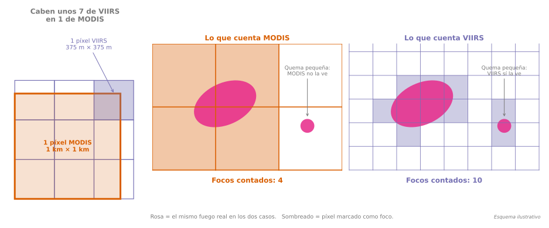
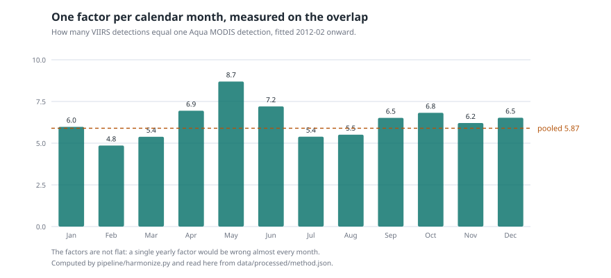

# Firetrack

**One comparable fire record from NASA MODIS and VIIRS.** A burning activity calendar for any area of
interest, so a fire manager can answer one question honestly: *is this month unusual, or is the record
just telling me that a new satellite turned on?*

NASA Space Apps Challenge 2026 — [*Harmonization of MODIS and VIIRS Hot Spots*](https://www.spaceappschallenge.org/).

**Status:** working end to end. Ingest (Portolan GeoParquet mirror of NASA FIRMS, no key), harmonization
clipped to the official boundary, artifacts, static export, API and web client all run. Demo regions:
`spain` (mainland and Balearic Islands) and `aragon`, whose factors borrow Spain's seasonal shape. The
figures below were measured on the earlier Iberia box and are redrawn by `python -m pipeline.charts`.


---

## 1. Why this is not a plotting exercise

A satellite does not see fires. It sees **pixels that are hotter than their surroundings**, and each one
counts as a hotspot. One large fire can light up dozens of pixels; a small stubble burn may light up one,
or none.

Two sensors share the record:

| | MODIS (Terra, Aqua) | VIIRS (S-NPP, NOAA-20, NOAA-21) |
|---|---|---|
| Nominal pixel | ~1 km | ~375 m |
| Record starts | 2000 | 2012 |
| Detects small fires | poorly | much better |
| Overpass (local) | ~10:30 and ~13:30 | ~13:30 and ~01:30 |

About **seven VIIRS pixels fit inside one MODIS pixel** (1000/375 ≈ 2.67, squared ≈ 7.1). So the same
1 km² fire yields one MODIS hotspot and roughly seven VIIRS hotspots — before counting the small fires
VIIRS sees and MODIS misses entirely.



Plot the raw counts and the series jumps the moment Suomi-NPP joins in 2012, and inflates again in 2024
once NOAA-21 is flying alongside NOAA-20 — while the fires themselves moved far less. Nothing changed on the
ground. Only the cameras did.

A single correction factor does not fix this, because the ratio is **seasonal**: during the dry season
both sensors see the large fires and VIIRS merely splits them into more pixels, but during agricultural
burning season VIIRS sees thousands of small fires that MODIS never detects.



## 2. The method

Think of it as an exchange rate between two currencies:

1. Take the period when both sensors operate (**2012 onward**).
2. For each calendar month, estimate *"when VIIRS sees X, Aqua MODIS sees Y"*. That is the month's rate.
3. Convert the whole series into **Aqua MODIS units**, so 2005 and 2024 become comparable.

**Why Aqua?** Its afternoon orbit (~13:30 local) is the only one that runs continuously from 2002 through
every VIIRS satellite. Calibrating against Aqua holds the diurnal cycle constant. Calibrating against
Terra (~10:30) would mix a change of sensor with a change of observation time.

**One factor per calendar month, day and night together.** Splitting them looks more honest and measures
worse: on Iberia the half-day factors differ three- to seven-fold while the day/night share drifts year to
year, and correcting each half separately overshot by 45–280 %. One factor per month lands at 3.5 % median
error. Sparse months are shrunk towards the pooled factor with an empirical-Bayes prior instead of claiming a
rate from three observations.

**One VIIRS at a time.** Suomi-NPP carries the series while it flies; NOAA-20 only fills the tail after
S-NPP stopped on 2026-11-02, with its own measured factor. Summing satellites is what creates the 2018 and
2024 steps in the first place. Terra bridges 2000-11 → 2002-06 through its own overlap factor.

**What the output is:** a **harmonized activity index**, not a count of fires. The UI always says so.
The native per-sensor counts stay available in the CSV export.

## 3. Data

All hotspot data comes from **[NASA FIRMS](https://firms.modaps.eosdis.nasa.gov/)** (Fire Information for
Resource Management System), read through the
**[Portolan mirror](https://source.coop/portolan-mirrors/firms-catalog)**: every FIRMS detection as one
GeoParquet file per year, CC0, no key and no rate limit. This is the only ingest path.

| Sensor in the mirror | Platform | Coverage |
|---|---|---|
| `MODIS` (C6.1, 1 km) | Terra, Aqua | 2000-11-01 → present (Aqua from 2002-07) |
| `VIIRS_SNPP` (375 m) | Suomi-NPP | 2012-01-20 → **2026-11-02 (mission ended)** |
| `VIIRS_NOAA20` (375 m) | NOAA-20 | 2018-04-01 → present |
| `VIIRS_NOAA21` (375 m) | NOAA-21 | 2024-01-17 → present |

Science-quality rows (`quality = 'sp'`) replace near-real-time rows (`'nrt'`) about three to four months
later, so the recent months are provisional. S-NPP stopped on 2026-11-02, so the recent tail depends on
NOAA-20 and NOAA-21. Last days are measured from the data (`sensor_days`), never hard-coded.

**What the mirror does and does not do.** It carries the FIRMS columns verbatim (only `geometry` instead of
latitude/longitude, expanded satellite names and an integer `confidence_pct` for MODIS). **Nothing is
harmonized upstream**: counts still jump when a satellite joins, `confidence` is still 0-100 for MODIS and
l/n/h for VIIRS, and `type` is empty for every near-real-time row. That work stays in `pipeline/`.

**How it is read.** Rows are sorted along a Hilbert curve in ~100k-row groups, each with its own bounding
box, so DuckDB downloads only the row groups that touch the region. For central Spain in 2016 that is 2 of
248 row groups. We read `year=YYYY/detections.parquet` only; the same folders also hold aggregates and a
`live.parquet` that repeats the last week.

**Verified against NASA (2026-11-15).** Detections in central Spain (-5.5, 38.5, -1.0, 42.3) counted in the
mirror and in the official NASA FIRMS country files are identical:

| Year | Aqua | Terra | Suomi-NPP | NOAA-20 |
|---|---|---|---|---|
| 2016 | 262 = 262 | 282 = 282 | 1,891 = 1,891 | |
| 2022 | 488 = 488 | 526 = 526 | 2,892 = 2,892 | 3,682 = 3,682 |

**What we cache** (`data/cache/<region>/<year>.parquet`): every detection with `acq_datetime`, `acq_date`,
`sensor`, `satellite`, `daynight`, `quality`, `version`, `type`, `confidence`, `confidence_pct`, `lat`, `lon`,
`frp`, `scan`, `track`. All confidence levels are kept; the filter (`CONF_SQL`: MODIS ≥ 30, VIIRS not `l`) is
applied in the harmonization step so its effect can be reported. `data/sensor_days.parquet` holds the days on
which each satellite delivered any detection anywhere on Earth: the denominator for partial months.

### Demo regions

| Region | Why | On the Aqua MODIS scale |
|---|---|---|
| **Spain** (mainland and Balearic Islands) | main demo: enough detections for a full calendar, and the per-month VIIRS/Aqua ratio really varies (day 3.4 to 5.6) | about 1,000 to 4,000 vegetation detections a year |
| **Aragón** | local story for the Zaragoza event | about 40 to 60 a year, so its calibration should borrow strength from Spain |

The ingest reads each region's bounding box, because that is what the mirror can prune on. Detections are then
clipped to the official boundary in `data/aoi/` (Instituto Geografico Nacional via geoBoundaries, CC BY 4.0,
simplified to about 300 m), so the box around Spain does not count fires in Portugal, Andorra or France. The
Canary Islands are left out: a different fire regime 1,000 km away, and the 2021 La Palma eruption adds about
31,000 detections that FIRMS types as vegetation. Ceuta and Melilla are left out too.

## 4. Architecture

```
NASA FIRMS ──► Portolan GeoParquet mirror (CC0, one file per year)
        │       read in place with DuckDB, only the region's row groups
        │  (pipeline only, never at request time)
        ▼
   pipeline/          firms (ingest) → normalize → harmonize (calibration, artifacts)
        │
        ▼
   data/processed/    Parquet artifacts, committed so a deploy needs no 158 s ingest
        │
        ▼
   services/api/      FastAPI + DuckDB, read-only
        │
        ▼
   apps/web/          Next.js + Tailwind; charts are hand-rolled SVG and CSS grid
```

The client ships no charting or map library: the calendar is a CSS grid, the series are inline SVG. One map
layer of hotspots is listed as a "should have" in the problem document and is not built.

Three deliberate boundaries:

- **The API never reads FIRMS or the mirror.** It serves precomputed artifacts only.
- **The pipeline is not the backend.** Merging them puts pandas and the whole ETL inside the API image.
- **Next.js is presentation only.** No DuckDB in serverless functions; the data layer stays in FastAPI.

## 5. Repository layout

```
apps/web/              Next.js client: calendar, panels, CSV download
  src/lib/             artifact types, API client, colour ramps and formatting
  src/components/      Dashboard shell and one component per panel
services/api/          FastAPI service and the artifact contract
pipeline/              ingest, normalizer, harmonizer, tests
  firms.py             ingest: Portolan mirror, per region and year cache, sensor days
  regions.py           loads data/regions.json and the boundaries, point-in-polygon clip
  normalize.py         sensor-agnostic schema, confidence and acquisition time
  harmonize.py         calibration, monthly index, validation, artifact writer
  charts.py            the two figures in docs/img, drawn from the artifacts
  export_web.py        static JSON and CSV for the web app, from the artifacts
data/regions.json      demo regions (Spain, Aragón), shared by pipeline and API
data/aoi/              official boundaries as GeoJSON (IGN via geoBoundaries, CC BY 4.0)
data/cache/            mirror reads, one Parquet per region and year (gitignored)
data/sensor_days.parquet  observing days per satellite (gitignored)
data/processed/        Parquet artifacts and method.json (committed, ~12 MB)
docs/                  problem definition in Spanish and English, diagrams
```

## 6. Quickstart

```powershell
python -m venv .venv
.\.venv\Scripts\Activate.ps1
pip install -r pipeline\requirements.txt -r services\api\requirements.txt
```

No key and no `.env` are needed. The first run downloads the DuckDB `spatial` and `httpfs` extensions and
the global sensor-days table (three columns per year, once):

```powershell
python -m pipeline.firms aragon --dry-run
python -m pipeline.firms aragon --from-year 2016 --to-year 2016
python -m pipeline.firms
python -m pipeline.harmonize spain
python -m pipeline.harmonize aragon --prior-region spain
python -m pipeline.export_web
```

The full Iberia ingest takes about 158 s and the harmonization a few seconds; both are resumable per year.
The summary printed by the ingest already shows the problem: the detection count per year jumps in 2012,
when Suomi-NPP joins. The harmonizer prints the factor table and the validation instead.

| Command | Purpose |
|---|---|
| `python -m pipeline.tests.test_firms` | bounding box, query and cache freshness (pure) |
| `python -m pipeline.tests.test_regions` | demo regions, boundary files and point-in-polygon (pure) |
| `python -m pipeline.tests.test_normalize` | confidence and time normalization (pure) |
| `python -m pipeline.tests.test_harmonize` | shrinkage, source preference, partial months, artifact contract |
| `python -m pipeline.firms` | ingest both demo regions (`spain`, `aragon`), resumable |
| `python -m pipeline.harmonize <region>` | build `data/processed/` for one region, clipped to its official boundary |
| `python -m pipeline.harmonize aragon --prior-region spain` | small region: monthly factors shrink towards Spain's |
| `python -m pipeline.export_web` | write `apps/web/public/data/` (static JSON and yearly CSV) for every built region |
| `python -m pipeline.charts` | redraw `docs/img/salto_2012.svg` and `factor_por_mes.svg` from the artifacts |
| `cd services\api; uvicorn main:app --reload` | API on <http://localhost:8000/docs> |
| `cd apps\web; npm install; npm run dev` | client on <http://localhost:3000>; reads `public/data/` (static), or the API when `NEXT_PUBLIC_API_BASE` is set |
| `cd apps\web; npm run build` | production build; the page is static, the data is fetched in the browser |

## 7. API

| Endpoint | Returns |
|---|---|
| `GET /health` | artifact availability per region |
| `GET /regions` | configured areas of interest |
| `GET /calendar?region=&start=&end=` | month × year matrix, raw counts, median per month, anomaly %, plus `partial` / `provisional` / `source` / `factor` / `observed_days` |
| `GET /detections?region=&start=&end=&limit=` | CSV of the detections behind the view (`Content-Disposition: attachment`) |
| `GET /method?region=` | calibration table, validation statistics (overlap and blind test), boundary clip, limitations |

The same payloads also exist as static files: `python -m pipeline.export_web` writes
`apps/web/public/data/{regions.json, calendar/<region>.json, method/<region>.json, detections/<region>/<year>.csv}`
with the code the API uses (`pipeline/payloads.py`), so the deployed site needs no server at all.

Missing artifacts return `503` with an actionable message. An empty chart that looks like "no fires" is
worse than an honest error. `partial` months and `provisional` years are served but kept out of the
per-month median, so the running month can never set the baseline it is compared against.

## 8. Quality gates

- **Unit tests** pin the silent failure modes: the area filter and the cache rule (a wrong box or a stale
  year means missing detections), confidence handling (MODIS `0–100` versus VIIRS `l/n/h`), and the
  harmonizer's shrinkage, source preference, partial-month rule and artifact contract.
- **Source check:** the mirror must match the official NASA FIRMS files on a test area (done for 2016 and
  2022, see §3).
- **Measured result (Iberia, calibrated 2012-02 → 2025):** median \|error\| against Aqua in the overlap
  **3.5 %**, worst 12.6 %. The 2011 → 2013 step is **+202.6 % raw**, **−25.9 % on the index** and **−24.6 %
  on Aqua itself**: the index tracks the ground, the raw count tracks the camera.
- **Correction test:** rebuild the record from VIIRS alone and check it against what Aqua actually observed.
- **Published limitations:** regions where the method under- or over-corrects are listed, not hidden.

## 9. Documentation

| Document | Language | Purpose |
|---|---|---|
| [`docs/problema.md`](docs/problema.md) | Spanish | canonical document: the problem in plain words, method, data, requirements, risks, schedule |
| [`docs/problem.md`](docs/problem.md) | English | full mirror of the canonical document, for the judges and the submission |

## 10. Attribution

Hotspot data: NASA FIRMS / LANCE, MODIS Collection 6.1 and VIIRS 375 m active fire products.
Region boundaries: Instituto Geografico Nacional (IGN), via geoBoundaries (https://www.geoboundaries.org/),
CC BY 4.0, simplified.
Read through the Portolan mirror of FIRMS on Source Cooperative (CC0):
<https://source.coop/portolan-mirrors/firms-catalog>.

We acknowledge the use of data and/or imagery from NASA's Fire Information for Resource Management System
(FIRMS) (https://earthdata.nasa.gov/firms), part of NASA's Earth Observing System Data and Information
System (EOSDIS).

The ingest approach (remote GeoParquet read in place with DuckDB, a per-year cache and a measured
sensor-days table) follows the one published by Kiln Watch (Team Off The Binary, NASA Space Apps 2026,
<https://github.com/Aalvee-Aarham/kiln-watch>). Our implementation is our own.
Fire imagery credit for the challenge: CONAE (National Commission of Space Activities of Argentina).
