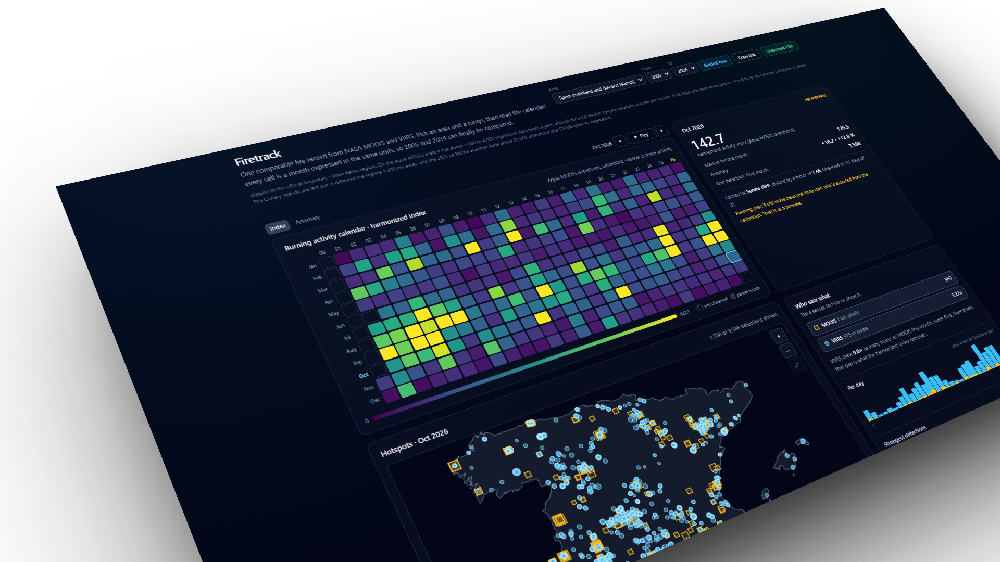
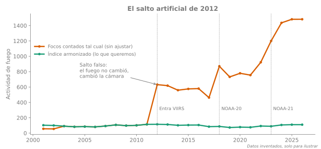
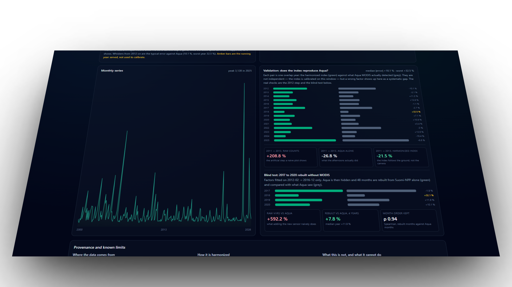
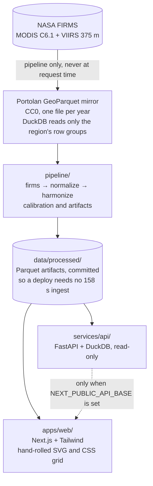

# Firetrack

<p align="center">
  <strong>A comparable fire-activity record from NASA MODIS and VIIRS, so changes in satellite coverage<br>
  do not look like changes in fire.</strong><br>
  A burning activity calendar for an area of interest, so a fire manager can answer one question honestly:<br>
  <em>is this month unusual, or is the record just telling me that a new satellite turned on?</em>
  <br><br>
  NASA Space Apps Challenge 2026 · <em>Harmonization of MODIS and VIIRS Hot Spots</em> · Team FireBallers · Spain
</p>

<p align="center">
  <a href="https://sebaspalate.github.io/firetrack/"></a>
  <a href="#the-proof"></a>
  <a href="docs/problem.md"></a>
</p>

<p align="center">
  <a href="https://firms.modaps.eosdis.nasa.gov/"></a>
  <a href="https://duckdb.org/"></a>
  <a href="https://fastapi.tiangolo.com/"></a>
  <a href="https://nextjs.org/"></a>
  <a href="https://react.dev/"></a>
</p>

<p align="center">
  
</p>

<table align="center">
  <tr>
    <td align="center"><strong>26 years</strong><br><sub>2000-11 to today</sub></td>
    <td align="center"><strong>5 satellites</strong><br><sub>Terra, Aqua, S-NPP, NOAA-20, NOAA-21</sub></td>
    <td align="center"><strong>2 sensors</strong><br><sub>MODIS 1 km · VIIRS 375 m</sub></td>
    <td align="center"><strong>10.1%</strong><br><sub>median error against Aqua</sub></td>
    <td align="center"><strong>2 regions</strong><br><sub>Spain · Aragón</sub></td>
  </tr>
</table>

> **The short version:** Firetrack harmonizes hotspot activity, not fires or burned area. It makes a
> 2005 observation comparable with a 2024 observation even though the satellite record changed.

## Explore Firetrack

The shortest way to understand Firetrack is to move from the experience to the evidence:

1. **Open the [live demo](https://sebaspalate.github.io/firetrack/).** Choose Spain or Aragón and inspect
   the calendar, map and monthly series.
2. **Look for the camera effect.** Compare the raw sensor counts with the harmonized index around 2012
   and 2024, when the available satellites changed.
3. **Check the evidence.** Read [the proof](#the-proof), then open the method and validation artifacts
   through the application or the [English write-up](docs/problem.md).

## What is ready

| Layer | What is included |
|---|---|
| Data | NASA FIRMS detections through the Portolan GeoParquet mirror; no API key required |
| Science | Monthly Aqua-referenced calibration, boundary clipping and validation against withheld observations |
| Product | Static Next.js demo, calendar, map, comparison series and native per-sensor CSV export |
| Reproducibility | Committed artifacts, focused tests and commands to rebuild the demo regions |
| Deployment | Public GitHub Pages demo built from `main` |

Demo regions are `spain` (mainland and Balearic Islands) and `aragon`, whose factors borrow Spain's
seasonal shape. The figures below are drawn from the `spain` artifacts by `python -m pipeline.charts`.

---

## The problem, in one picture

The camera changed twice and the record moved both times. The only question worth asking is whether the
fires moved with it.



### Why this is not a plotting exercise

A satellite does not see fires. It sees **pixels that are hotter than their surroundings**, and each one
counts as a hotspot. One large fire can light up dozens of pixels; a small stubble burn may light up one,
or none.

Two sensors share the record:

| | MODIS (Terra, Aqua) | VIIRS (S-NPP, NOAA-20, NOAA-21) |
|---|---|---|
| Nominal pixel | ~1 km | ~375 m |
| Record starts | 2000 | 2012 |
| Detects small fires | poorly | much better |
| Overpass (local) | ~10:30 and ~13:30 | ~13:30 and ~01:30 |

About **seven VIIRS pixels fit inside one MODIS pixel** (1000/375 ≈ 2.67, squared ≈ 7.1). So the same
1 km² fire yields one MODIS hotspot and roughly seven VIIRS hotspots — before counting the small fires
VIIRS sees and MODIS misses entirely.


Plot the raw counts and the series jumps the moment Suomi-NPP joins in 2012, and inflates again in 2024
once NOAA-21 is flying alongside NOAA-20 — while the fires themselves moved far less. Nothing changed on the
ground. Only the cameras did.

A single correction factor does not fix this, because the ratio is **seasonal**: during the dry season
both sensors see the large fires and VIIRS merely splits them into more pixels, but during agricultural
burning season VIIRS sees thousands of small fires that MODIS never detects.


## The method

Think of it as an exchange rate between two currencies:

1. Take the period when both sensors operate (**2012 onward**).
2. For each calendar month, estimate *"when VIIRS sees X, Aqua MODIS sees Y"*. That is the month's rate.
3. Convert the whole series into **Aqua MODIS units**, so 2005 and 2024 become comparable.

**Why Aqua?** Its afternoon orbit (~13:30 local) is the only one that runs continuously from 2002 through
every VIIRS satellite. Calibrating against Aqua holds the diurnal cycle constant. Calibrating against
Terra (~10:30) would mix a change of sensor with a change of observation time.

**One factor per calendar month, day and night together.** Splitting them looks more honest and measures
worse: on the earlier Iberia box the half-day factors differ three- to seven-fold while the day/night share
drifts year to year, and correcting each half separately overshot by 45–280 %. One factor per month lands at
a 10.1 % median error on Spain (worst year 32.5 %); the retired Iberia box measured 3.5 %. Sparse months are
shrunk towards the pooled factor with an empirical-Bayes prior instead of claiming a rate from three
observations.

**One VIIRS at a time.** Suomi-NPP carries the series while it flies; NOAA-20 only fills the tail after
S-NPP stopped on 2026-11-02, with its own measured factor. Summing satellites is what creates the 2018 and
2024 steps in the first place. Terra bridges 2000-11 → 2002-06 through its own overlap factor.

**What the output is:** a **harmonized activity index**, not a count of fires. The UI always says so.
The native per-sensor counts stay available in the CSV export.

## The proof

The index is measured against the camera that saw both eras, and the record is rebuilt with a satellite
taken away to see whether it survives without it.

When Suomi-NPP changes the camera, the raw count and the index disagree about what happened:

| 2011 → 2013 step | Change |
|---|---|
| Raw VIIRS counts | **+208.8 %** |
| Harmonized index | **−21.5 %** |
| Aqua MODIS itself | **−26.8 %** |

The index tracks the ground; the raw count tracks the camera.

Against Aqua through the overlap on Spain (**2012-02 → 2025**), the index lands at a median \|error\| of
**10.1 %**, worst year **32.5 %** (2018).

The blind test is the honest error bar: the factors are refitted on 2012-02 → 2016-12, Aqua is hidden, and
2017-2020 is rebuilt from Suomi-NPP alone. It lands at **7.8 %** total error against Aqua (raw VIIRS:
**592.2 %**), a median year error of **11.9 %**, and a monthly Spearman rank correlation of **0.943**.

### How we check it

- **Unit tests** pin the silent failure modes: the area filter and the cache rule (a wrong box or a stale
  year means missing detections), confidence handling (MODIS `0–100` versus VIIRS `l/n/h`), and the
  harmonizer's shrinkage, source preference, partial-month rule and artifact contract.
- **Source check:** the mirror must match the official NASA FIRMS files on a test area (done for 2016 and
  2022, see the Data section below).
- **Correction test:** rebuild the record from VIIRS alone and check it against what Aqua actually observed.

## Where this still falls short

We publish these, not hide them.

- **The recent tail is provisional.** Science-quality rows (`quality = 'sp'`) replace near-real-time rows
  (`'nrt'`) about three to four months later, and S-NPP stopped on 2026-11-02, so the index tail rests on
  NOAA-20 with its own measured factor. NOAA-21 stays in the raw counts and the CSV, never summed into the
  index.
- **Partial months are never the baseline.** They are served but kept out of the per-month median, so the
  running month can never set the yardstick it is compared against.
- **The worst year is not 10.1 % off, it is 32.5 % (2018).** The median is the honest summary; the tail is
  where the method under- or over-corrects, and those years are listed in the artifacts rather than smoothed
  away.
- **Two regions, one borrowed shape.** Aragón has about 40 to 60 vegetation detections a year, so its
  seasonal factors shrink towards Spain's instead of claiming a shape of its own.
- **A custom area is not validated on its own.** It borrows Spain's factors as they are, because the
  per-sensor coverage a box would need to fit its own calibration is not published. It works only inside
  the Spain data, and a small box with few detections is noisy.
- **Boundaries are a choice.** The Canary Islands are excluded (a different fire regime 1,000 km away, and
  the 2021 La Palma eruption adds about 31,000 detections that FIRMS types as vegetation). Ceuta and
  Melilla are excluded too.
- **An index is not a fire inventory.** Detections are pixels, not fires and not burned area.

## The product

<p align="center">
  
</p>

The client ships no charting or map library: the calendar is a CSS grid, the series are inline SVG, and
the hotspot map is inline SVG drawn on the same official boundary the detections were clipped to, so it
works offline in the demo.

- **The calendar** is a CSS grid: every cell is a month in the same units, with the count, the anomaly and
  the partial/provisional flag.
- **The series** are inline SVG, drawn from the artifacts, with error whiskers from the year the overlap
  starts.
- **The map** puts every hotspot on the official boundary, so the box you picked and the fires you see are
  the same place.
- **A custom area of interest**: pick *Custom area* and type a west/south/east/north box, or press
  *Draw area* on the map and drag a rectangle. The calendar, map and CSV are computed in the browser from
  the Spain detections inside the box, with Spain's monthly factors and the pipeline's own calendar rules;
  a box around all of Spain reproduces `calendar/spain.json` exactly (`npm test`).
- **The view is the URL** (`?region=aragon&year=2024&month=8&series=compare`, or
  `?region=custom&aoi=-1,41,0,42` for a custom box), so any state can be shared as a link.
- **The export** is the native per-sensor CSV behind whatever you are looking at.

## Who it is for

| For a fire manager | For an analyst |
|---|---|
| **Is this month unusual?** Compare it against 26 years of the same calendar month, in the same units, not against a period where the camera was different. | **Can I compare 2005 with 2024?** Yes, and the method, the factors and the validation statistics download with the series. |
| **Aragón** is the local case: few detections, so its shape borrows Spain's instead of inventing one. | **Spain** is the full-calendar case: enough detections for every month, and a VIIRS/Aqua ratio that really varies (day 3.4 to 5.6). |

## How it is built



Three deliberate boundaries:

- **The API never reads FIRMS or the mirror.** It serves precomputed artifacts only.
- **The pipeline is not the backend.** Merging them puts pandas and the whole ETL inside the API image.
- **Next.js is presentation only.** No DuckDB in serverless functions; the data layer stays in FastAPI.

**Languages.** Python for ingest, harmonization and the API; TypeScript for the client; SQL through
DuckDB for every query that spans more than one year.

## How AI was used

AI was a directed engineering tool here, not an author of the claims. Every number in this repository is
produced by the pipeline in `pipeline/`, from code that is committed and reviewable.

- **Harness.** OpenCode and Pi as coding agents, directed through the gentle-ai orchestration layer —
  planning, bounded tasks and verification gates — inside VS Code, with a person reading every change
  before it was accepted.
- **Amazon Quick** for requirements analysis, image generation with Amazon Nova Canvas, and parts of the
  execution.

What we did not delegate: the framing of the problem, the harmonization method, the decision to validate
against Aqua, and the choice of demo regions. Those are ours, and `docs/problem.md` is the record of them.

## Repository layout

```
apps/web/      Next.js client: calendar, panels, CSV download
services/api/  FastAPI service and the artifact contract
pipeline/      ingest, normalizer, harmonizer, tests
data/          demo regions, official boundaries, artifacts
docs/          write-ups, generated figures, README artwork
.github/       CI, the data build and the Pages deploy
```

<details>
<summary><code>apps/web/</code> — presentation only, no data layer</summary>

<br>

```
src/app/         layout.tsx, page.tsx, globals.css: shell, dark theme, Tailwind entry
src/components/  Dashboard holds the state, the URL sync and the controls; one file
                 per panel: CalendarHeatmap, MonthlySeries, YearlyTotals,
                 Seasonality, MapPanel, DetailPanel, Validation, Provenance,
                 TimeControls, GuidedTour
src/lib/         the contract and the plumbing: types.ts, api.ts, urlState.ts,
                 geo.ts, detections.ts, colors.ts, format.ts
public/data/     the static export the browser reads (regions, calendar, method, CSV)
```

</details>

<details>
<summary><code>services/api/</code> — read-only, artifacts only</summary>

<br>

```
main.py            FastAPI app: /health, /regions, /calendar, /detections, /method
requirements.txt
```

</details>

<details>
<summary><code>pipeline/</code> — the work that only runs offline</summary>

<br>

```
firms.py           ingest: Portolan mirror, per region and year cache, sensor days
normalize.py       sensor-agnostic schema, confidence and acquisition time
harmonize.py       calibration, monthly index, validation, artifact writer
payloads.py        the response contract shared by the API and the static export
regions.py         data/regions.json and the boundaries, point-in-polygon clip
export_web.py      static JSON and CSV for the web app
charts.py          the two generated figures in docs/img
env.py             settings and cache paths
tests/             one file per silent failure mode: firms, regions, normalize,
                   harmonize, payloads
```

</details>

<details>
<summary><code>data/</code> — what is committed and what is rebuilt</summary>

<br>

```
regions.json          demo regions (Spain, Aragón), shared by pipeline and API
aoi/                  official boundaries as GeoJSON (IGN via geoBoundaries, CC BY 4.0)
processed/            Parquet artifacts and method.json (committed, ~12 MB)
cache/                mirror reads, one Parquet per region and year (gitignored)
sensor_days.parquet   observing days per satellite (gitignored)
```

</details>

<details>
<summary><code>docs/</code> and <code>.github/</code></summary>

<br>

```
docs/problema.md      canonical document, Spanish
docs/problem.md       full mirror, English
docs/img/             the figures; two are redrawn by python -m pipeline.charts
docs/readme/          hero.png and product.png, hand-made

.github/workflows/    ci.yml runs the pipeline tests and the web lint and build;
                      build-data.yml rebuilds the artifacts and opens a PR;
                      deploy-pages.yml ships the static site
```

</details>

<details>
<summary><b>Run it</b> (Python 3.13, Node 22)</summary>

<br>

```powershell
python -m venv .venv
.\.venv\Scripts\Activate.ps1
pip install -r pipeline\requirements.txt -r services\api\requirements.txt
```

No key and no `.env` are needed. The first run downloads the DuckDB `spatial` and `httpfs` extensions and
the global sensor-days table (three columns per year, once):

```powershell
python -m pipeline.firms spain --dry-run
python -m pipeline.firms spain --from-year 2016 --to-year 2016
python -m pipeline.firms spain aragon
python -m pipeline.harmonize spain
python -m pipeline.harmonize aragon --prior-region spain
python -m pipeline.export_web
```

The earlier full-Iberia ingest took about 158 s and the harmonization a few seconds; the ingest is resumable
per year, so a rerun only fetches what is missing.
The summary printed by the ingest already shows the problem: the detection count per year jumps in 2012,
when Suomi-NPP joins. The harmonizer prints the factor table and the validation instead.

| Command | Purpose |
|---|---|
| `python -m pipeline.tests.test_firms` | bounding box, query and cache freshness (pure) |
| `python -m pipeline.tests.test_regions` | demo regions, boundary files and point-in-polygon (pure) |
| `python -m pipeline.tests.test_normalize` | confidence and time normalization (pure) |
| `python -m pipeline.tests.test_harmonize` | shrinkage, source preference, partial months, artifact contract |
| `python -m pipeline.firms` | ingest both demo regions (`spain`, `aragon`), resumable |
| `python -m pipeline.harmonize <region>` | build `data/processed/` for one region, clipped to its official boundary |
| `python -m pipeline.harmonize aragon --prior-region spain` | small region: monthly factors shrink towards Spain's |
| `python -m pipeline.export_web` | write `apps/web/public/data/` (static JSON, yearly CSV and the boundary outline) for every built region |
| `python -m pipeline.charts` | redraw `docs/img/salto_2012.svg` and `factor_por_mes.svg` from the artifacts |
| `cd services\api; uvicorn main:app --reload` | API on <http://localhost:8000/docs> |
| `cd apps\web; npm install; npm run dev` | client on <http://localhost:3000>; reads `public/data/` (static), or the API when `NEXT_PUBLIC_API_BASE` is set |
| `cd apps\web; npm test` | web tests: the custom-area calendar against the pipeline's Spain calendar |
| `cd apps\web; npm run build` | production build; the page is static, the data is fetched in the browser |

</details>

<details>
<summary><b>Data</b></summary>

<br>

All hotspot data comes from **[NASA FIRMS](https://firms.modaps.eosdis.nasa.gov/)** (Fire Information for
Resource Management System), read through the
**[Portolan mirror](https://source.coop/portolan-mirrors/firms-catalog)**: every FIRMS detection as one
GeoParquet file per year, CC0, no key and no rate limit. This is the only ingest path.

| Sensor in the mirror | Platform | Coverage |
|---|---|---|
| `MODIS` (C6.1, 1 km) | Terra, Aqua | 2000-11-01 → present (Aqua from 2002-07) |
| `VIIRS_SNPP` (375 m) | Suomi-NPP | 2012-01-20 → **2026-11-02 (mission ended)** |
| `VIIRS_NOAA20` (375 m) | NOAA-20 | 2018-04-01 → present |
| `VIIRS_NOAA21` (375 m) | NOAA-21 | 2024-01-17 → present |

Science-quality rows (`quality = 'sp'`) replace near-real-time rows (`'nrt'`) about three to four months
later, so the recent months are provisional. S-NPP stopped on 2026-11-02, so the index tail rests on
NOAA-20; NOAA-21 is in the raw counts, the map and the CSV but is never summed into the index. Last days are
measured from the data (`sensor_days`), never hard-coded.

**What the mirror does and does not do.** It carries the FIRMS columns verbatim (only `geometry` instead of
latitude/longitude, expanded satellite names and an integer `confidence_pct` for MODIS). **Nothing is
harmonized upstream**: counts still jump when a satellite joins, `confidence` is still 0-100 for MODIS and
l/n/h for VIIRS, and `type` is empty for every near-real-time row. That work stays in `pipeline/`.

**How it is read.** Rows are sorted along a Hilbert curve in ~100k-row groups, each with its own bounding
box, so DuckDB downloads only the row groups that touch the region. For central Spain in 2016 that is 2 of
248 row groups. We read `year=YYYY/detections.parquet` only; the same folders also hold aggregates and a
`live.parquet` that repeats the last week.

**Verified against NASA (2026-11-15).** Detections in central Spain (-5.5, 38.5, -1.0, 42.3) counted in the
mirror and in the official NASA FIRMS country files are identical:

| Year | Aqua | Terra | Suomi-NPP | NOAA-20 |
|---|---|---|---|---|
| 2016 | 262 = 262 | 282 = 282 | 1,891 = 1,891 | |
| 2022 | 488 = 488 | 526 = 526 | 2,892 = 2,892 | 3,682 = 3,682 |

**What we cache** (`data/cache/<region>/<year>.parquet`): every detection with `acq_datetime`, `acq_date`,
`sensor`, `satellite`, `daynight`, `quality`, `version`, `type`, `confidence`, `confidence_pct`, `lat`, `lon`,
`frp`, `scan`, `track`. All confidence levels are kept; the filter (`CONF_SQL`: MODIS ≥ 30, VIIRS not `l`) is
applied in the harmonization step so its effect can be reported. `data/sensor_days.parquet` holds the days on
which each satellite delivered any detection anywhere on Earth: the denominator for partial months.

### Demo regions

| Region | Why | On the Aqua MODIS scale |
|---|---|---|
| **Spain** (mainland and Balearic Islands) | main demo: enough detections for a full calendar, and the per-month VIIRS/Aqua ratio really varies (day 3.4 to 5.6) | about 1,000 to 4,000 vegetation detections a year |
| **Aragón** | local story for the Zaragoza event | about 40 to 60 a year, so its calibration should borrow strength from Spain |

The ingest reads each region's bounding box, because that is what the mirror can prune on. Detections are then
clipped to the official boundary in `data/aoi/` (Instituto Geografico Nacional via geoBoundaries, CC BY 4.0,
simplified to about 300 m), so the box around Spain does not count fires in Portugal, Andorra or France. The
Canary Islands are left out: a different fire regime 1,000 km away, and the 2021 La Palma eruption adds about
31,000 detections that FIRMS types as vegetation. Ceuta and Melilla are left out too.

</details>

<details>
<summary><b>API</b></summary>

<br>

| Endpoint | Returns |
|---|---|
| `GET /health` | artifact availability per region |
| `GET /regions` | configured areas of interest |
| `GET /calendar?region=&start=&end=` | month × year matrix, raw counts, median per month, anomaly %, plus `partial` / `provisional` / `source` / `factor` / `observed_days` |
| `GET /detections?region=&start=&end=&limit=` | CSV of the detections behind the view (`Content-Disposition: attachment`) |
| `GET /method?region=` | calibration table, validation statistics (overlap and blind test), boundary clip, limitations |

The same payloads also exist as static files: `python -m pipeline.export_web` writes
`apps/web/public/data/{regions.json, calendar/<region>.json, method/<region>.json, detections/<region>/<year>.csv}`
with the code the API uses (`pipeline/payloads.py`), so the deployed site needs no server at all.

Missing artifacts return `503` with an actionable message. An empty chart that looks like "no fires" is
worse than an honest error. `partial` months and `provisional` years are served but kept out of the
per-month median, so the running month can never set the baseline it is compared against.

</details>

## Documentation

| Document | Language | Purpose |
|---|---|---|
| [`docs/problema.md`](docs/problema.md) | Spanish | canonical document: the problem in plain words, method, data, requirements, risks |
| [`docs/problem.md`](docs/problem.md) | English | full technical reference for the method, data and validation |

## Attribution

Hotspot data: NASA FIRMS / LANCE, MODIS Collection 6.1 and VIIRS 375 m active fire products.
Region boundaries: Instituto Geografico Nacional (IGN), via geoBoundaries (https://www.geoboundaries.org/),
CC BY 4.0, simplified.
Read through the Portolan mirror of FIRMS on Source Cooperative (CC0):
<https://source.coop/portolan-mirrors/firms-catalog>.

Software: Next.js 16, React 19 and Tailwind CSS 4 on the client; FastAPI, DuckDB, pandas and PyArrow in
Python 3.13. No map library, no tile server and no chart library: the map and the figures are SVG drawn
by this repository.

Images: `docs/readme/hero.png` and `docs/readme/product.png` are screenshots of this app; the three
figures in `docs/img/` are generated from the artifacts by `python -m pipeline.charts`. No third-party
imagery is used.

We acknowledge the use of data and/or imagery from NASA's Fire Information for Resource Management System
(FIRMS) (https://earthdata.nasa.gov/firms), part of NASA's Earth Observing System Data and Information
System (EOSDIS).
