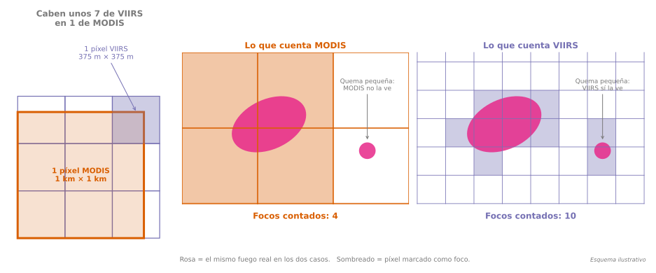
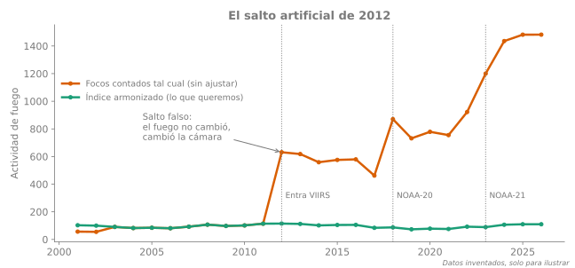
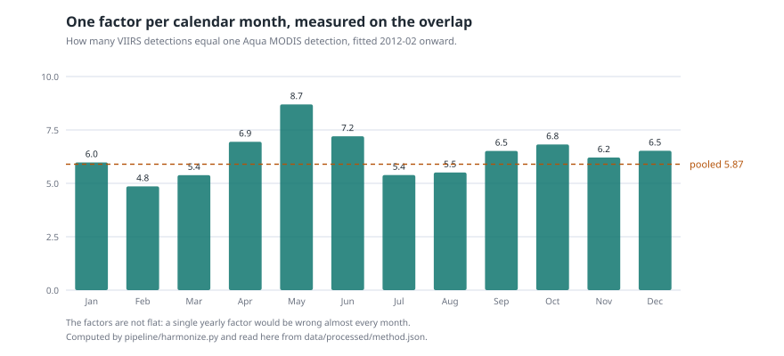

# Firetrack — Harmonization of MODIS and VIIRS Hot Spots

**Event:** NASA Space Apps Challenge 2026 — *Harmonization of MODIS and VIIRS Hot Spots*
**Team:** 3 people — software engineering (dev), mechanical engineering, industrial engineering
**Window:** Saturday 11:00 → Sunday 23:59 (37 h wall clock)
**Code freeze:** Sunday 20:00. **Submission:** Sunday 21:30. **Buffer:** until 23:59.
**Status:** working code skeleton; no data artifacts yet.
**Language:** submission document for the judges. The team working document is `docs/problema.md` (Spanish).

> Mirror of `docs/problema.md`, which is canonical. If the two diverge, the Spanish document wins.
> Regenerate this file from it before the code freeze.

---

# Part I — The problem

## 1. What we count: a hotspot is not a fire

A satellite does not see fires. It sees **pixels that are hotter than their surroundings**, and each of
those pixels counts as a hotspot.

- **1 fire ≠ 1 hotspot.** A large fire can occupy dozens of pixels. A small stubble burn is one pixel, or none.
- What we count are **hot pixels**, not fires.

The whole language of the product depends on this distinction. The app never says "340 fires"; it says
activity index. If a judge or a user reads "fires", the number is false.

## 2. The problem: two different cameras looking at the same fire

Imagine counting the people in a square with two cameras:

| | MODIS (old camera) | VIIRS (new camera) |
|---|---|---|
| Pixel size | ~1 km × 1 km | ~375 m × 375 m |
| Since | 2000 (Terra), 2002 (Aqua) | 2012 (S-NPP), 2018 (NOAA-20), 2023 (NOAA-21) |
| Detects small fires | poorly | much better |
| Overpass (local) | ~10:30 (Terra) and ~13:30 (Aqua) | ~13:30 and ~01:30 |

About **seven VIIRS pixels fit inside one MODIS pixel** (1000 / 375 ≈ 2.67; 2.67² ≈ 7.1). The same 1 km²
fire yields **one MODIS hotspot and roughly seven VIIRS hotspots**. On top of that, VIIRS detects small
burns that MODIS never sees.



The fire is exactly the same in both cases, yet VIIRS counts more than twice as many hotspots. And the
small burn on the right does not appear in MODIS at all.

**Consequence:** plot the historical series as-is and the count explodes in 2012. It looks like there is
suddenly far more fire, when the only thing that changed is the camera.



> It is like swapping the traffic radar for a more sensitive one and concluding that people drive worse.

## 3. Why dividing by seven is not enough

The difference between sensors **changes with the season**:

- **Dry season (large fires):** both sensors see the fire and VIIRS merely splits it into more pixels. The
  difference is moderate.
- **Small agricultural burning season:** MODIS barely sees any of it and VIIRS sees all of it. The
  difference is enormous.

Made-up example: in August VIIRS counts 6× MODIS, and in February 15× MODIS. A single factor for the whole
year would be wrong almost every month.



Purple bars are the months where a single factor would fall short, and green bars the months where it would
overshoot. **That is why we compute a different factor for each calendar month.**

## 4. The time of the snapshot matters too

Fire follows a daily cycle: it burns harder in the afternoon (heat and wind) and less before dawn.

| Satellite | Sensor | Overpass (local) |
|---|---|---|
| Terra | MODIS | ~10:30 |
| Aqua | MODIS | ~13:30 |
| S-NPP, NOAA-20, NOAA-21 | VIIRS | ~13:30 |

Comparing Terra with VIIRS would compare a mid-morning snapshot with an early-afternoon one.
**That is why we use Aqua as the reference:** it is the same kind of camera as MODIS, it crosses at the
same time as VIIRS, and it has run continuously from 2002 to today.

## 5. The number of satellites also changes over the years

| Year | What happens |
|---|---|
| 2000 | Terra only (MODIS) |
| 2002 | Aqua joins (MODIS) |
| 2012 | The first VIIRS joins (S-NPP) |
| 2018 | NOAA-20 joins (VIIRS) |
| 2023 | NOAA-21 joins (VIIRS) |
| 2026 | S-NPP stops delivering data (2 November) |

The more satellites, the more overpasses and the more hotspots counted. That creates jumps in the series
that have nothing to do with fire: that is why the jump chart has **three steps**, not one.

---

# Part II — The challenge

## 6. What the challenge asks for

Two phases, both mandatory:

1. **Harmonize** MODIS and VIIRS hotspots, so the sensor of origin no longer matters and patterns, trends
   and anomalies become the focus.
2. **Build a web application** on top of that harmonized data. The user picks an area and a date range and gets:
   - A **burning activity calendar** (hotspots per month and year, from 2000 to today).
   - Which months and years had the most fire.
   - A comparison of the current month against the **historical median**.
   - Accessible color ramps.
   - A **CSV download** of the hotspots found.

### 6.1 Output contract

| # | Output | Where the challenge asks for it |
|---|---|---|
| O1 | Burning activity calendar, early 2000s → present, harmonized | "A calendar of burning activity ... a view of the fire history" |
| O2 | Which periods of the year see more fire / which years had more activity | same paragraph |
| O3 | Current month vs historical median | "compare the burning activity of the current month against the historical median" |
| O4 | Region selection (draw AOI, or lat/lon) | "Potential Considerations" |
| O5 | Accessible color ramps | "Consider using accessible color ramps" |
| O6 | CSV download of the hotspots in the search | "A downloadable CSV File of hot spots detected during a search" |
| O7 | Anomalies against multi-year averages | "Historical comparisons, including anomalies against multi-year averages" |

### 6.2 Optional suggestions in the challenge text

Users: early warning and emergency services, scientists, land managers and firefighters. An interactive map
for drawing the area or entering latitude and longitude. Few but clear indicators: anomalies against
multi-year averages and the number of detected fires.

### 6.3 Resources

The Resources tab has a single link: **[FIRMS – NASA Earthdata](https://www.earthdata.nasa.gov/data/tools/firms)**,
the source of the MODIS and VIIRS hotspots. In the Space Apps forum a participant estimates the global
historical record at roughly **45 GB of CSV** `[THIRD-PARTY ESTIMATE, unverified]`. That is why limiting
ourselves to regions makes sense instead of processing the whole planet.

Note: that link is a **catalog page**, not an API. The real API lives at
`firms.modaps.eosdis.nasa.gov/api/area/` and requires a `MAP_KEY` (§9.1).

## 7. The solution: an exchange rate

It is like comparing 1995 prices in pesetas with 2020 prices in euros: first you convert them to the same
currency.

1. Take the period when **both sensors operate simultaneously** (2012 onward).
2. For each calendar month, compute *"when VIIRS sees X, Aqua sees Y"*. That is that month's exchange rate.
3. Convert the whole series into **Aqua MODIS units**, so 2005 and 2024 become comparable.

### 7.1 Why Aqua and not an average

Aqua is the only orbit that stays continuous from 2002 and spans the era of every VIIRS satellite, with the
same overpass time (~13:30). Calibrating against Aqua holds the diurnal cycle constant. Calibrating against
Terra (10:30) or against a MODIS average mixes a change of sensor with a change of observation time. Terra
only acts as a bridge for 2000–2002.

Implementation detail: ratio of totals per calendar month, **day and night separately**, with empirical-Bayes
shrinkage for cells with few samples.

### 7.2 Strategies considered

| ID | Strategy | Pros | Cons |
|---|---|---|---|
| H1 | Coarse grid + normalization by observation opportunity | principled | needs valid-overpass counts, which FIRMS does not deliver cleanly |
| H2 | **Overlap-window calibration** (ratio of totals per calendar month) | directly answers the problem, demonstrable | needs enough samples per cell |
| H3 | **Binary presence** per cell-month (fire / no fire) | nearly sensor-independent, cheap | loses intensity |
| H4 | Counts weighted by FRP or filtered by confidence | physically meaningful | still biased by resolution |

**Choice:** H2 as the primary series, H3 as an independent sanity check, both on a **0.25° and 1° grid**,
monthly resolution. Delivered as a *harmonized activity index*, never as a "number of fires". Native counts
stay in the CSV with a `sensor` column.

### 7.3 What it is for

With the series on the same scale, one can finally answer: *"did this August have more fire than normal in
the Chaco?"* We compare this August against the median of every August since 2000. If it is 40 % above, that
is a real anomaly and not an effect of the satellite change. That is what firefighters, emergency services,
scientists and land managers need.

## 8. Requirements (testable)

- **S1** AOI by bbox (drawing on the map or typing west/south/east/north). Invalid input shows a specific message and does not query.
- **S2** Date range constrained to 2000-11-01 → present; the default is the full record.
- **S3** The burning calendar renders months (rows) × years (columns) from the harmonized series, using a colorblind-safe sequential ramp, with a legend stating the units ("harmonized activity index").
- **S4** For any selected month+year, the app shows the value, the multi-year median for that calendar month, and the anomaly as both absolute delta and percentage.
- **S5** The app renders the monthly time series over the selected range.
- **S6** The app renders month-of-year seasonality (mean or median per month across years) for the AOI.
- **S7** CSV download contains the harmonized fields plus raw native fields and `sensor`, for exactly the current AOI + range.
- **S8** A visible provenance panel states sources, harmonization method, overlap-calibration window, and known limitations.
- **S9** A typical AOI query returns from the precomputed store in under 2 s.
- **S10** Harmonization quality gate: during the overlap window, the calibrated index reproduces the MODIS-native series within a stated tolerance; a chart proving this exists in the repo and is linked from the app.

## 9. Data — verified plan (2026-11-14)

### 9.1 `MAP_KEY`

A free key tied to an email address. Request it at `firms.modaps.eosdis.nasa.gov/api/map_key/`; it arrives
by email and authenticates the area API and the map services. It is not a user account or a subscription.

- Limit: **5000 transactions / 10 min**; a request for N days costs roughly N transactions.
- If the email is already registered, the form will not resend the key: it is managed from the download portal.
- It is a credential: it lives in `.env` (gitignored), never in the repo.

### 9.2 Real coverage per product

| Product | Coverage |
|---|---|
| MODIS C6.1 (SP) | 2000-11-01 → present (~5 month lag) |
| VIIRS S-NPP 375 m (SP) | 2012-01-20 → **2026-11-02 (ended)** |
| VIIRS NOAA-20 375 m (SP) | 2018-04-01 → present |
| VIIRS NOAA-21 375 m (SP) | 2023-03-01 → present |

**Critical finding:** S-NPP no longer delivers data. With S-NPP alone the series does not reach "today":
the recent tail needs NOAA-20 and `_NRT` for the last few months.

### 9.3 Chosen ingest (no Earthdata account)

Area API in 5-day chunks (maximum `DAY_RANGE`), over bounded AOIs. The pipeline is **idempotent and
resumable** per `(aoi, sensor, window)`: if it is interrupted, it does not re-download what it already has.

Budget measured with `scripts/budget.py`:

| Regions | Transactions | Wall clock waiting on the rate limit |
|---|---|---|
| 1 | 19,416 | ~0.6 h |
| 3 | 58,248 | ~1.9 h |
| 6 | 116,496 | ~3.9 h |
| 9 | 174,744 | ~5.8 h |

With 37 h, **3 regions fit comfortably**; 6 only if the ingest runs in the background while the UI is being
built. There is still a single developer: the real limit is their time, not the API.

### 9.4 Historical archive (rejected for today)

It requires Earthdata Login or an emailed code, allows **one global year per request**, and delivery is
**asynchronous by email**. It is the right path for "the whole planet", but not viable in this window. It
stays as plan B and as a source for one cross-validation year.

### 9.5 Scope consequence

- **Primary:** predefined regions with the full 2000 → present calendar.
- **Secondary:** arbitrary AOI in "limited coverage" mode (short window, declared in the UI).
- **Rejected:** the full global 0.25° grid. A global monthly grid is ~1.04 M cells × 300 months: that is a
  backend, not something you send to a browser.

### 9.6 Fields that must be harmonized

Common: `latitude`, `longitude`, `acq_date`, `acq_time`, `satellite`, `instrument`, `frp`, `daynight`, `type`.
Divergent: `brightness`/`bright_ti4`, `bright_t31`/`bright_ti5`, `scan`, `track`, `confidence` (0–100 vs
l/n/h), `version`. Unified schema: `sensor`, `platform`, `pixel_km`, `confidence_score` (0–1 normalized),
`frp`, `datetime_utc`, `cell_id`.

### 9.7 Geographic scope

`data/regions.json` defines the AOIs. Candidates: **Chaco** (CONAE photo credit, Argentine local story),
**Iberia/Aragón** (team proximity and European audience), Amazon, Cerrado, California, Australia SE,
Siberia, Sahel and Borneo.

## 10. Scope

**Must have:** precomputed dataset (2000 → present, MODIS + VIIRS); AOI and range selection; month × year
calendar with an accessible ramp; seasonality and yearly totals; comparison against the historical median
and anomaly; CSV download; provenance panel.

**Should have:** map layer of hotspots; shareable URL; FRP toggle; third region; polygon drawing if time
allows.

**Won't have:** user accounts; streaming beyond the recent tail; per-pixel harmonization.

## 11. Demo script (5 minutes)

1. Pick the demo region with the full record.
2. The calendar fills in: dry-season band visible, 2024 vs 2005 **without** the artificial jump.
3. Hover a month: value, median, anomaly.
4. Switch to seasonality and yearly totals.
5. Download the CSV live.
6. Show the calibration chart and state the limitation out loud.

## 12. Risks

| ID | Risk | Impact | Mitigation |
|---|---|---|---|
| R1 | Historical archive account or volume blocks the ingest | kills harmonization | the chosen ingest does not need it (§9.3); the archive stays as plan B |
| R2 | Harmonization is judged not credible | weak submission | index + validation chart + disclosed limits (S8, S10) |
| R3 | Scope creep into polygons / auth / live data | no demo | bbox only, presets, precomputed data |
| R4 | A single developer for data + web | bottleneck | pipeline first, UI second; B and C carry validation, requirements, QA and delivery |
| R5 | VIIRS confidence is categorical vs MODIS numeric | silent filtering bug | single `confidence_score`, with a unit test (implemented) |
| R6 | Date drift from `acq_date` + `acq_time` | off-by-one months in the calendar | `datetime_utc` in the unified schema (implemented) |
| R7 | The 5000 transactions / 10 min limit | incomplete ingest | measured budget (§9.3) and a resumable cache |
| R8 | The series says "index" but the UI hints "fires" | credibility | §1 and S3 fix the language; C reviews it in QA |

## 13. Work split

| Track | Owner | Owns | Done when |
|---|---|---|---|
| **A. Data & software** | Software engineer | Pipeline (ingest → normalize → grid → harmonize → artifacts), API, calendar and chart frontend, CSV | S1–S9 pass on the demo AOI; the repo reproduces the dataset from scripts |
| **B. Physical validation** | Mechanical engineer | Overpass geometry, footprint vs scan angle, detection thresholds, meaning of FRP; calibration methodology; validation against known events (2019 Amazon, 2019–20 Australia, 2023 Canada); `docs/method.md` | Method calibrated with a validation chart on real events, plus physical assumptions and failure modes in writing |
| **C. Product & delivery** | Industrial engineer | Responder user and journey, operational definition of "anomaly", QA plan and checklist, risk register, submission text, demo script, video, README for the judges | Requirements signed, QA executed before each run, materials ready 90 min ahead |

This challenge is won or lost on **method credibility and communication**, not on CRUD.

## 14. Timeline (37 h wall clock)

| Block | Clock | Goal | Owner |
|---|---|---|---|
| **B0 Kickoff** | Sat 11:00–12:30 | decisions closed, stack fixed, repo ready | All |
| **B1 Data audit** | Sat 12:30–15:00 | `MAP_KEY`, timed probe, one AOI loaded with 3 sensors | A (B in parallel) |
| **B2 Pipeline v0** | Sat 15:00–21:00 | normalized dataset + harmonized grid, calibration chart | A |
| **B2b Parallel** | Sat 15:00–21:00 | `docs/method.md` and validation events / requirements frozen and script | B / C |
| **Dinner + sync (G1)** | Sat 21:00–22:00 | gate review | All |
| **B3 App core** | Sat 22:00–Sun 02:00 | AOI + range → calendar + median on real data | A |
| **Rest** | Sun 02:00–07:00 | sleep, mandatory | All |
| **B4 Remaining data** | Sun 07:00–11:00 | complete regions in the background; normalization and artifacts | A |
| **B5 Validation + QA** | Sun 11:00–14:00 | S10 validated, CSV, provenance, QA executed | B/C + A |
| **B6 Full UI** | Sun 14:00–17:00 | seasonality, map, accessibility, deploy | A |
| **B7 Third region / should-have** | Sun 17:00–18:30 | only if G3 passed | A + B |
| **B8 Rehearsal** | Sun 18:30–20:00 | full run of the script against the real deploy | All |
| **G4 Code freeze** | Sun 20:00 | code closed | All |
| **B9 Video + form** | Sun 20:00–21:30 | video, final README, form | C |
| **Submission** | Sun 21:30 | upload and **confirm receipt** | C |
| **Buffer** | Sun 21:30–23:59 | text fixes only, no code | — |

### Decision gates (cut scope, never stretch time)

- **G0 — Sat 12:30.** No stack or no decisions: minimum is a Python pipeline + single-page app.
- **G1 — Sat 21:00.** No harmonized grid: cut to MODIS + S-NPP with global calibration.
- **G2 — Sun 02:00.** If the calendar does not render real data, Sunday goes into that and map and seasonality are dropped.
- **G3 — Sun 17:00.** No map or no stable deploy: B7 is dropped and we close with what exists.
- **G4 — Sun 20:00.** Code freeze. No code enters after this hour.
- **G5 — Sun 21:30.** Submission uploaded and confirmed. Never left until 23:59: forms fall over at the last minute.

---

# Part III — Execution

## 15. Decisions

| ID | Decision | Reason |
|---|---|---|
| **D1** | Monorepo `apps/web` + `services/api` + `pipeline/` + `data/` | The pipeline is not the backend |
| **D2** | Predefined regions with the full record; arbitrary AOI in limited mode | API ingest cannot cover the planet |
| **D3** | `MODIS_SP` + `VIIRS_SNPP_SP` + `VIIRS_NOAA20_SP` (+ NRT on the tail) | S-NPP ends on 2026-11-02 |
| **D4** | Commit aggregates only, never raw detections | Repository size vs reproducibility |
| **D5** | Next.js on Vercel; FastAPI on Railway/Render/Fly | Two simple, free deployments |
| **D6** | **Demo region:** Chaco vs Iberia/Aragón — `[OPEN]` | Chaco = CONAE story; Iberia = team proximity |

## 16. Stack

```
apps/web/          Next.js + TypeScript + Tailwind + Plotly + MapLibre
services/api/      FastAPI + DuckDB
pipeline/          Python: ingest → normalize → grid → harmonize
data/              regions.json + artifacts (raw and Parquet gitignored)
```

**FastAPI and not Django:** a read-only analytics service with 5 endpoints. No auth, no admin, no
migrations, no ORM. DuckDB over Parquet is a SQL query; FastAPI gives free `/docs`.

**Next.js yes, with one condition:** data logic does **not** live in `app/api/*` or in Server Components.
DuckDB in serverless is a trap. Next is presentation; FastAPI is data.

**API contract:** `/health`, `/regions`, `/calendar`, `/detections`, `/method`. Returns `503` with an
actionable message when an artifact is missing: an empty chart that looks like "no fires" is worse than an
honest error.

## 17. Competition (2026)

- `Aalvee-Aarham/kiln-watch` — team from Bangladesh, same challenge already published: FastAPI + React +
  MapLibre, DuckDB over remote GeoParquet, Aqua-reference calibration, a "denial" test, 95 % intervals,
  9 regions and an AI agent. They report 5 of 9 regions inside the no-change range, Punjab ~7 % below and
  Paraná Delta +27 %.
- `nasa/spaceapps#1786` — several teams go for *spatio-temporal matching* and clustering into "fire events"
  instead of calibrating totals.

**Implication:** the generic global calendar already exists. Competing on feature count is a losing move.
The open space is local impact, responder workflow and auditable validation.

## 18. Next actions

1. Request the `MAP_KEY` and run `scripts/check_firms.py` to measure real latency.
2. Measure row volume per sensor-year and fix the grid with evidence.
3. Generate the first real `calendar.json` for one AOI, and only then start the UI.
4. Freeze S1–S10; anything new goes to "Should have".

## 19. Glossary

| Term | What it means here |
|---|---|
| **Hotspot** | A pixel detected as thermally anomalous. Not a fire. |
| **FRP** | *Fire Radiative Power*: energy emitted by the pixel. More FRP ≈ more intense fire. |
| **Harmonization** | Converting counts from different sensors to a comparable scale. |
| **Harmonized index** | The result of harmonization. It compares; it does not count fires. |
| **Historical median** | The typical value of that same month across every year of the record. |
| **Anomaly** | How far a month deviates from its median, in percent. |
| **AOI** | *Area of Interest*: the area the user selects. |
| **SP / NRT** | *Standard Processing* (science quality, ~5 month lag) / *Near Real-Time*. |

## 20. Contribution log

- **`FIRST EXPLANATION`** (commit `e8d8253`, team): challenge summary, the observation that the difference
  between sensors **changes with the season** and that therefore a single factor is not enough (basis of
  §3 and §7), the FIRMS link, the 45 GB estimate and the proposal to bound the scope to one region. Its
  text is preserved in §2, §6 and §9.7.
- **`firetrack_problema_explicado`** (team): a jargon-free document and three diagrams. Contributes the
  framing that **a hotspot is a hot pixel, not a fire** (§1), the **7:1** ratio (§2), the satellite-by-year
  table (§5), the exchange-rate analogy (§7) and the glossary (§19). The diagrams live in `docs/img/`.
  Integrated here in full: it does not remain as a separate file.
- **Technical verification** (commit `67324a0`): `DAY_RANGE` 1–5, `MAP_KEY` and its limit, real coverage
  per sensor including the end of S-NPP, measured transaction budget, requirements, risks, schedule and
  stack.
