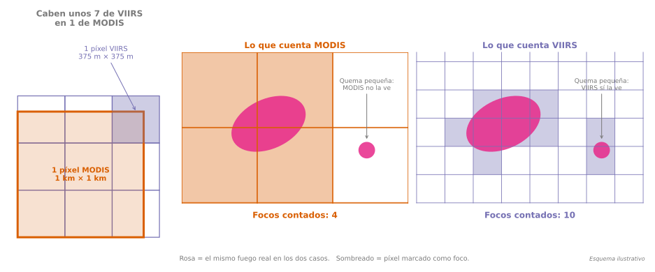
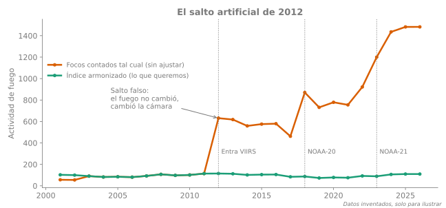
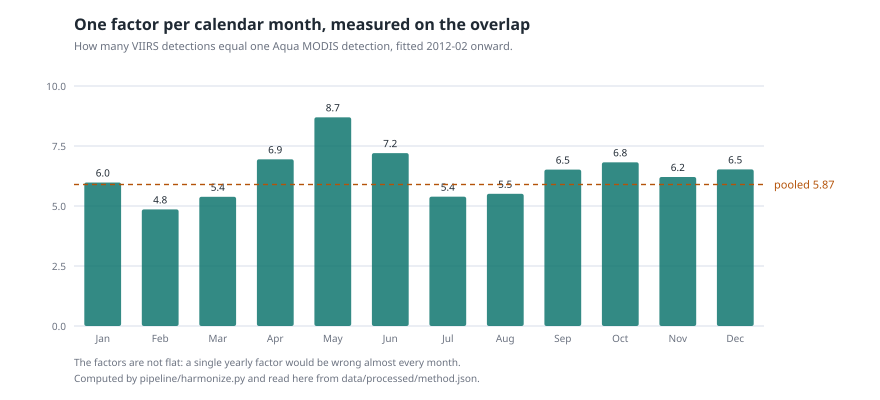

# Firetrack: el problema explicado fácil

> Documento de entrada, complementario a [`problema.md`](problema.md). Explica con palabras sencillas
> **qué problema queremos resolver y por qué no es trivial**, para que cualquiera que se sume al equipo
> lo entienda sin tener que leer la parte técnica.
>
> Si buscás las decisiones, el método, los datos y el cronograma, eso está en `problema.md`.

---

## 1. Qué es un "hotspot" (foco)

El satélite no ve incendios. Ve **píxeles más calientes de lo normal**, y cada uno de esos píxeles cuenta
como un foco.

- **1 incendio no es 1 foco.** Un incendio grande puede ocupar decenas de píxeles. Una quema pequeña de
  rastrojo, uno solo o ninguno.
- Lo que contamos son **píxeles calientes**, no incendios.

---

## 2. Dos cámaras distintas mirando el mismo fuego

Imagina que cuentas la gente de una plaza con dos cámaras:

| | MODIS (cámara antigua) | VIIRS (cámara nueva) |
|---|---|---|
| Tamaño del píxel | ~1 km × 1 km | ~375 m × 375 m |
| Desde | 2000 | 2012 |
| Detecta fuegos pequeños | Poco | Mucho mejor |

En el espacio de **1 píxel de MODIS caben unos 7 de VIIRS** (1000 / 375 ≈ 2,67; 2,67² ≈ 7,1). Un mismo
incendio de 1 km² da **1 foco en MODIS y unos 7 en VIIRS**. Además, VIIRS detecta quemas pequeñas que
MODIS ni ve.

El fuego es exactamente el mismo en los dos casos, pero VIIRS cuenta más del doble de focos. Y la quema
pequeña de la derecha ni siquiera aparece en MODIS.

**Consecuencia:** si pintamos la serie histórica tal cual, en 2012 el número de focos se dispara. Parece
que de repente hay muchísimo más fuego, pero lo único que ha cambiado es la cámara.

> Es como cambiar el radar de tráfico por uno más sensible y concluir que la gente conduce peor.

---

## 3. Por qué no basta con dividir entre 7

La diferencia entre sensores **cambia según la época del año**:

- **Época seca (incendios grandes):** los dos sensores ven el fuego y VIIRS solo lo "trocea" en más
  píxeles. La diferencia es moderada.
- **Época de quemas agrícolas pequeñas:** MODIS no ve casi ninguna y VIIRS las ve todas. La diferencia es
  enorme.

Ejemplo inventado: en agosto VIIRS cuenta 6 veces más que MODIS, y en febrero 15 veces más. Un único
factor para todo el año estaría mal casi todos los meses.

Las barras moradas son los meses en que un factor único se quedaría corto, y las verdes, los meses en que
se pasaría.

**Por eso calculamos un factor distinto para cada mes del año.**

---

## 4. La hora de la foto también importa

El fuego sigue un ciclo diario: arde más por la tarde (calor y viento) y menos de madrugada.

| Satélite | Sensor | Hora de paso (local) |
|---|---|---|
| Terra | MODIS | ~10:30 |
| Aqua | MODIS | ~13:30 |
| S-NPP, NOAA-20, NOAA-21 | VIIRS | ~13:30 |

Comparar Terra con VIIRS sería comparar una foto de media mañana con una de primera hora de la tarde.

**Por eso usamos Aqua como referencia:** es el mismo tipo de cámara que MODIS, pasa a la misma hora que
VIIRS y funciona de forma continua desde 2002 hasta hoy.

---

## 5. El número de satélites también cambia con los años

| Año | Qué pasa |
|---|---|
| 2000 | Solo Terra (MODIS) |
| 2002 | Se suma Aqua (MODIS) |
| 2012 | Entra el primer VIIRS (S-NPP) |
| 2018 | Se suma NOAA-20 (VIIRS) |
| 2023 | Se suma NOAA-21 (VIIRS) |
| 2026 | S-NPP deja de dar datos (2 de noviembre) |

Cuantos más satélites hay, más pasadas y más focos se cuentan. Esto también crea saltos en la serie que no
tienen nada que ver con el fuego.

---

## 6. La solución: un "tipo de cambio"

Es como comparar precios de 1995 en pesetas con precios de 2020 en euros: antes hay que pasarlos a la
misma moneda.

1. Tomamos el periodo en que **los dos sensores funcionan a la vez** (de 2012 en adelante).
2. Para cada mes del año calculamos: *"cuando VIIRS ve X, Aqua ve Y"*. Ese es el tipo de cambio de ese mes.
3. Pasamos toda la serie a **"unidades Aqua MODIS"**, y así 2005 y 2024 se pueden comparar.

### Importante

El resultado **no es un número de incendios**, sino un **índice de actividad armonizado**. Sirve para
comparar meses y años entre sí, no para decir "hubo 340 incendios". En la app siempre lo llamaremos así.

---

## 7. Para qué sirve todo esto

Con la serie ya en la misma escala, por fin se puede responder:

> *"¿Este agosto ha tenido más fuego de lo normal en el Chaco?"*

Comparamos el valor de este agosto con la **mediana de todos los agostos desde el 2000**. Si está un 40 %
por encima, es una **anomalía real** y no un efecto del cambio de satélite.

Eso es lo que necesitan bomberos, servicios de emergencia, científicos y gestores del territorio.

---

## En una frase

**Tenemos 25 años de datos de fuego tomados con cámaras distintas, a horas distintas y con distinto número
de satélites. Firetrack los pasa a una misma escala para poder comparar cualquier mes con lo que es
normal.**

---

## Glosario mínimo

| Término | Qué significa acá |
|---|---|
| **Foco / hotspot** | Píxel detectado como térmicamente anómalo. No es un incendio. |
| **FRP** | *Fire Radiative Power*: energía que emite el píxel. Más FRP ≈ fuego más intenso. |
| **Ajuste / armonización** | Convertir conteos de distintos sensores a una escala comparable. |
| **Índice armonizado** | El resultado del ajuste. Compara, no cuenta incendios. |
| **Mediana histórica** | Valor típico de ese mismo mes a lo largo de todos los años del registro. |
| **Anomalía** | Cuánto se aparta un mes de su mediana, en porcentaje. |
| **AOI** | *Area of Interest*: la zona que el usuario elige en el mapa. |
