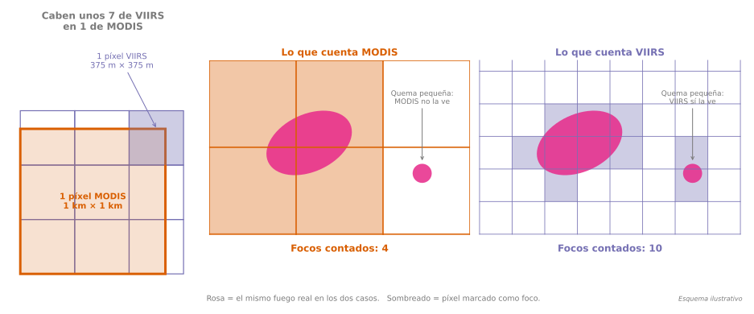
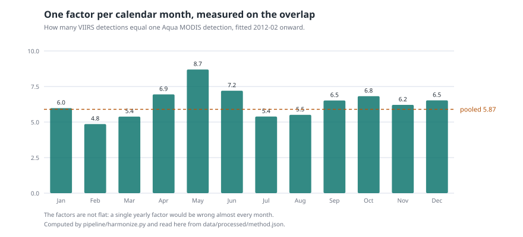

# Firetrack — Armonización de hotspots MODIS y VIIRS

**Evento:** NASA Space Apps Challenge 2026 — *Harmonization of MODIS and VIIRS Hot Spots*
**Equipo:** 3 personas — ingeniería de software (dev), ingeniería mecánica, ingeniería industrial
**Ventana real:** sábado 11:00 → domingo 23:59 (37 h de reloj)
**Congelamiento de código:** domingo 20:00. **Envío:** domingo 21:30. **Colchón:** hasta 23:59.
**Estado:** esqueleto de código funcionando; sin artefactos de datos todavía.
**Idioma:** documento de trabajo del equipo. La entrega, la presentación y el README final van en inglés.

> Documento único del problema. `docs/problem.md` es la versión en inglés, equivalente, para el jurado.
> Se regenera desde acá antes del cierre: si hay divergencia, manda este.

---

# Parte I — El problema

## 1. Qué contamos: un foco no es un incendio

El satélite no ve incendios. Ve **píxeles más calientes de lo normal**, y cada uno de esos píxeles cuenta
como un foco.

- **1 incendio no es 1 foco.** Un incendio grande puede ocupar decenas de píxeles. Una quema pequeña de
  rastrojo, uno solo o ninguno.
- Lo que contamos son **píxeles calientes**, no incendios.

Todo el lenguaje del producto depende de esta distinción. La app nunca dice "340 incendios", dice índice
de actividad. Si el jurado o el usuario lee "incendios", el número es falso.

## 2. El problema: dos cámaras distintas mirando el mismo fuego

Imagina que cuentas la gente de una plaza con dos cámaras:

| | MODIS (cámara antigua) | VIIRS (cámara nueva) |
|---|---|---|
| Tamaño del píxel | ~1 km × 1 km | ~375 m × 375 m |
| Desde | 2000 (Terra), 2002 (Aqua) | 2012 (S-NPP), 2018 (NOAA-20), 2024 (NOAA-21) |
| Detecta fuegos pequeños | Poco | Mucho mejor |
| Hora de paso (local) | ~10:30 (Terra) y ~13:30 (Aqua) | ~13:30 y ~01:30 |

En el espacio de **1 píxel de MODIS caben unos 7 de VIIRS** (1000 / 375 ≈ 2,67; 2,67² ≈ 7,1). Un mismo
incendio de 1 km² da **1 foco en MODIS y unos 7 en VIIRS**. Además, VIIRS detecta quemas pequeñas que
MODIS ni ve.



El fuego es exactamente el mismo en los dos casos, pero VIIRS cuenta más del doble de focos. Y la quema
pequeña de la derecha ni siquiera aparece en MODIS.

**Consecuencia:** si pintamos la serie histórica tal cual, en 2012 el número de focos se dispara. Parece
que de repente hay muchísimo más fuego, pero lo único que ha cambiado es la cámara.


> Es como cambiar el radar de tráfico por uno más sensible y concluir que la gente conduce peor.

## 3. Por qué no basta con dividir entre siete

La diferencia entre sensores **cambia según la época del año**:

- **Época seca (incendios grandes):** los dos sensores ven el fuego y VIIRS solo lo "trocea" en más
  píxeles. La diferencia es moderada.
- **Época de quemas agrícolas pequeñas:** MODIS no ve casi ninguna y VIIRS las ve todas. La diferencia es
  enorme.

Ejemplo inventado: en agosto VIIRS cuenta 6 veces más que MODIS, y en febrero 15 veces más. Un único factor
para todo el año estaría mal casi todos los meses.



Las barras moradas son los meses en que un factor único se quedaría corto, y las verdes, los meses en que
se pasaría. **Por eso calculamos un factor distinto para cada mes del año.**

## 4. La hora de la foto también importa

El fuego sigue un ciclo diario: arde más por la tarde (calor y viento) y menos de madrugada.

| Satélite | Sensor | Hora de paso (local) |
|---|---|---|
| Terra | MODIS | ~10:30 |
| Aqua | MODIS | ~13:30 |
| S-NPP, NOAA-20, NOAA-21 | VIIRS | ~13:30 |

Comparar Terra con VIIRS sería comparar una foto de media mañana con una de primera hora de la tarde.
**Por eso usamos Aqua como referencia:** es el mismo tipo de cámara que MODIS, pasa a la misma hora que
VIIRS y funciona de forma continua desde 2002 hasta hoy.

## 5. El número de satélites también cambia con los años

| Año | Qué pasa |
|---|---|
| 2000 | Solo Terra (MODIS) |
| 2002 | Se suma Aqua (MODIS) |
| 2012 | Entra el primer VIIRS (S-NPP) |
| 2018 | Se suma NOAA-20 (VIIRS) |
| 2024 | Se suma NOAA-21 (VIIRS), desde el 17 de enero en los datos de FIRMS |
| 2026 | S-NPP deja de dar datos (2 de noviembre) |

Cuantos más satélites hay, más pasadas y más focos se cuentan. Eso crea saltos en la serie que no tienen
nada que ver con el fuego: por eso el gráfico del salto tiene **tres escalones**, no uno.

---

# Parte II — El desafío

## 6. Lo que piden

Dos fases, ambas obligatorias:

1. **Armonizar** los focos de MODIS y VIIRS, para que no importe de qué sensor viene el dato y lo
   importante sean los patrones, tendencias y anomalías.
2. **Hacer una aplicación web** que use esos datos armonizados. El usuario elige una zona y un rango de
   fechas y obtiene:
   - Un **calendario de actividad de quemas** (focos por mes y año, desde los 2000 hasta hoy).
   - Qué meses y qué años tuvieron más fuego.
   - Una comparación del mes actual con la **mediana histórica**.
   - Escalas de color accesibles.
   - Descarga en **CSV** de los focos encontrados.

### 6.1 Contrato de salidas

| # | Salida | Dónde lo pide |
|---|---|---|
| O1 | Calendario de actividad de quema, inicios de 2000 → presente, armonizado | "A calendar of burning activity ... a view of the fire history" |
| O2 | Qué épocas del año tienen más fuego / qué años tuvieron más actividad | mismo párrafo |
| O3 | Mes actual vs mediana histórica | "compare the burning activity of the current month against the historical median" |
| O4 | Selección de región (dibujar AOI, o lat/lon) | "Potential Considerations" |
| O5 | Rampas de color accesibles | "Consider using accessible color ramps" |
| O6 | Descarga CSV de los hotspots de la búsqueda | "A downloadable CSV File of hot spots detected during a search" |
| O7 | Anomalías contra promedios multianuales | "Historical comparisons, including anomalies against multi-year averages" |

### 6.2 Sugerencias opcionales del reto

Usuarios: servicios de alerta temprana y emergencias, científicos, gestores del territorio y bomberos.
Mapa interactivo para dibujar la zona o meter latitud y longitud. Pocos indicadores pero claros:
anomalías frente a medias de varios años y número de incendios detectados.

### 6.3 Recursos

La pestaña Resources trae un solo enlace: **[FIRMS – NASA Earthdata](https://www.earthdata.nasa.gov/data/tools/firms)**,
la fuente de los focos de MODIS y VIIRS. En el foro de Space Apps un participante estima el histórico
global en unos **45 GB en CSV** `[ESTIMACIÓN DE TERCEROS, no verificada]`. Por eso tiene sentido
limitarse a regiones en vez de procesar el planeta entero.

Ojo: ese enlace es una **ficha de catálogo**, no una fuente de datos. Los focos los leemos del mirror
Portolan, una copia pública de FIRMS que no pide clave (§9.3).

## 7. La solución: un "tipo de cambio"

Es como comparar precios de 1995 en pesetas con precios de 2020 en euros: antes hay que pasarlos a la
misma moneda.

1. Tomamos el periodo en que **los dos sensores funcionan a la vez** (2012 en adelante).
2. Para cada mes del año calculamos *"cuando VIIRS ve X, Aqua ve Y"*. Ese es el tipo de cambio de ese mes.
3. Pasamos toda la serie a **unidades Aqua MODIS**, y así 2005 y 2024 se pueden comparar.

### 7.1 Por qué Aqua y no un promedio

Aqua es la única órbita que se mantiene continua desde 2002 y atraviesa la era de todos los satélites
VIIRS, con la misma hora de paso que ellos (~13:30). Calibrar contra Aqua mantiene constante el ciclo
diurno. Calibrar contra Terra (10:30) o contra un promedio de MODIS mezcla cambio de sensor con cambio de
hora de observación. Terra actúa solo como puente 2000–2002.

Detalle de implementación: razón de totales por mes calendario, **un solo factor por mes, día y noche
juntos**, con suavizado tipo empirical Bayes para celdas con pocas muestras. Separar día y noche parecía más
honesto y mide peor: en Iberia los factores de cada mitad difieren entre 3 y 7 veces y la proporción de
detecciones diurnas se mueve año a año, así que corregir cada mitad por separado sobrecorrige entre 45 % y
280 %. Con un factor por mes el error mediano contra Aqua queda en 3,5 %.

Un solo VIIRS a la vez: Suomi-NPP lleva la serie mientras vuela y NOAA-20 solo rellena la cola desde que
S-NPP terminó (2026-11-02), con su propio factor medido. Sumar satélites es exactamente el salto que este
proyecto existe para eliminar.

### 7.2 Estrategias consideradas

| ID | Estrategia | A favor | En contra |
|---|---|---|---|
| H1 | Grilla gruesa + normalización por oportunidad de observación | principalista | requiere contar pasadas válidas, que FIRMS no entrega limpio |
| H2 | **Calibración por ventana de solapamiento** (razón de totales por mes calendario) | responde directo al problema, demostrable | necesita muestras suficientes por celda |
| H3 | **Presencia binaria** por celda-mes (hubo / no hubo fuego) | casi independiente del sensor, barato | pierde intensidad |
| H4 | Conteos ponderados por FRP o filtrados por confianza | físicamente significativo | sigue sesgado por resolución |

**Elección:** H2 como serie primaria, H3 como control de sanidad independiente, ambas a grilla de **0.25°
y 1°**, resolución mensual. Se entrega como *índice de actividad armonizado*, nunca como "cantidad de
incendios". Los conteos nativos quedan en el CSV con columna `sensor`.

### 7.3 Para qué sirve

Con la serie en la misma escala, por fin se puede responder: *"¿este agosto ha tenido más fuego de lo
normal en el Chaco?"*. Comparamos el valor de este agosto con la mediana de todos los agostos desde el
2000. Si está 40 % por encima, es una anomalía real y no un efecto del cambio de satélite. Eso es lo que
necesitan bomberos, emergencias, científicos y gestores del territorio.

## 8. Requisitos (verificables)

- **S1** AOI por bbox (dibujando en el mapa o tipeando oeste/sur/este/norte). Entrada inválida muestra un mensaje específico y no consulta.
- **S2** Rango de fechas acotado a 2000-11-01 → presente; por defecto, el registro completo.
- **S3** Calendario meses (filas) × años (columnas) desde la serie armonizada, con rampa secuencial segura para daltonismo y leyenda que declare la unidad ("índice de actividad armonizado").
- **S4** Para cualquier mes+año, muestra el valor, la mediana multianual de ese mes calendario y la anomalía en delta absoluto y porcentaje.
- **S5** Serie mensual sobre el rango elegido.
- **S6** Estacionalidad (media o mediana por mes calendario a través de los años).
- **S7** CSV con campos armonizados más campos nativos y `sensor`, exactamente para el AOI + rango actual.
- **S8** Panel de procedencia visible: fuentes, método, ventana de calibración y limitaciones.
- **S9** Consulta típica de AOI por debajo de 2 s desde el almacén precomputado.
- **S10** Puerta de calidad: durante la ventana de solapamiento, el índice calibrado reproduce la serie nativa de Aqua MODIS dentro de una tolerancia declarada; el gráfico que lo prueba está en el repo y enlazado desde la app.

## 9. Datos — plan verificado (2026-11-15)

### 9.1 Acceso sin clave

No usamos `MAP_KEY` ni la API de área de FIRMS. Los datos se leen del mirror Portolan (§9.3), que es
público, no tiene límite de peticiones ni ventana de 5 días. El repo no necesita ni guarda ninguna
credencial.

### 9.2 Cobertura real por satélite (en el mirror)

| `sensor` | Satélite | Cobertura |
|---|---|---|
| `MODIS` (C6.1, 1 km) | Terra, Aqua | 2000-11-01 → presente (Aqua desde julio de 2002) |
| `VIIRS_SNPP` (375 m) | Suomi-NPP | 2012-01-20 → **2026-11-02 (terminado)** |
| `VIIRS_NOAA20` (375 m) | NOAA-20 | 2018-04-01 → presente |
| `VIIRS_NOAA21` (375 m) | NOAA-21 | 2024-01-17 → presente |

Las filas definitivas (`sp`) sustituyen a las de tiempo casi real (`nrt`) unos 3 o 4 meses después, así que
los últimos meses son provisionales. FIRMS publica NOAA-21 definitivo desde el 2023-03-01, pero el mirror lo
trae desde el 2024-01-17.

**Hallazgo crítico:** S-NPP ya no entrega datos. La cola reciente depende de NOAA-20, NOAA-21 y las filas
NRT. Los últimos días de cada satélite se miden en los datos (`sensor_days`), nunca se escriben a mano.

### 9.3 Ingesta: mirror Portolan (única vía, decisión D7)

**Fuente:** el [mirror Portolan de FIRMS](https://source.coop/portolan-mirrors/firms-catalog), una copia
pública (CC0) de todas las detecciones de FIRMS, MODIS y VIIRS, en un archivo GeoParquet por año
(`year=AAAA/detections.parquet`). Las filas van ordenadas por una curva de Hilbert en bloques de unas 100.000,
cada uno con su rectángulo, así que DuckDB solo descarga los bloques que tocan la región. Para el centro de
España en 2016 son 2 bloques de 248.

Lo importante: **el mirror no armoniza nada**. Copia las columnas de FIRMS tal cual. Los conteos siguen
saltando cuando entra un satélite, la confianza sigue siendo 0-100 en MODIS y l/n/h en VIIRS, y `type` va
vacío en todas las filas NRT. Toda la normalización sigue siendo trabajo nuestro, en `pipeline/`.

`pipeline/firms.py` guarda un archivo por región y año (`data/cache/<región>/<año>.parquet`) con todos los
niveles de confianza, y `data/sensor_days.parquet` con los días en que cada satélite mandó datos. Es
**idempotente y reanudable**: los años cerrados no se vuelven a bajar y el año en curso se refresca cada 6 h.

**Comprobación contra NASA (2026-11-15).** Contamos las detecciones del centro de España (-5,5; 38,5; -1,0;
42,3) en el mirror y en los archivos oficiales por país de NASA FIRMS. Salen idénticas:

| Año | Aqua | Terra | Suomi-NPP | NOAA-20 |
|---|---|---|---|---|
| 2016 | 262 = 262 | 282 = 282 | 1.891 = 1.891 | |
| 2022 | 488 = 488 | 526 = 526 | 2.892 = 2.892 | 3.682 = 3.682 |

El diseño (leer el GeoParquet remoto con DuckDB, caché por año y días de observación medidos) es el mismo que
usa Kiln Watch en su `firms.py` (equipo Off The Binary). El código es nuestro.

### 9.4 Archivo histórico de FIRMS (descartado)

Requiere Earthdata Login o código por email, permite **un año global por pedido** y la entrega es
**asíncrona por email**. Ya no hace falta: el mirror cubre de 2000 a hoy sin cuenta.

### 9.5 Consecuencia de alcance

- **Primario:** regiones predefinidas con calendario completo 2000 → presente.
- **Secundario:** AOI arbitraria en modo "cobertura limitada" (ventana corta, declarada en la UI).
- **Descartado:** grilla global 0.25° completa. Un grid mensual global son ~1,04 M celdas × 300 meses: es
  un backend, no algo que se pueda enviar al navegador.

### 9.6 Campos a armonizar

Comunes: `latitude`, `longitude`, `acq_date`, `acq_time`, `satellite`, `instrument`, `frp`, `daynight`, `type`.
Divergentes: `brightness`/`bright_ti4`, `bright_t31`/`bright_ti5`, `scan`, `track`, `confidence` (0–100 vs l/n/h), `version`.
Esquema unificado: `sensor`, `platform`, `pixel_km`, `confidence_score` (0–1 normalizado), `frp`, `datetime_utc`, `cell_id`.

### 9.7 Acotado geográfico

`data/regions.json` define las AOIs. Candidatas: **Chaco** (crédito de foto de CONAE, relato local
argentino), **Iberia/Aragón** (cercanía del equipo y audiencia europea), Amazonía, Cerrado, California,
Australia SE, Siberia, Sahel y Borneo.

## 10. Alcance

**Imprescindible:** dataset precomputado (2000→presente, MODIS + VIIRS); selección de AOI y rango;
calendario mes × año con rampa accesible; estacionalidad y totales por año; comparación con mediana
histórica y anomalía; descarga CSV; panel de procedencia.

**Deseable:** capa de mapa con hotspots; URL compartible; alternar FRP; tercera región; dibujo de
polígono si sobra tiempo.

**Fuera de alcance:** cuentas de usuario; streaming más allá de la cola reciente; armonización píxel a
píxel.

## 11. Guion del demo (5 minutos)

1. Elegir la región del demo con el registro completo.
2. El calendario se llena: banda de estación seca visible, 2024 vs 2005 **sin** el salto artificial.
3. Pasar el mouse por un mes: valor, mediana, anomalía.
4. Cambiar a estacionalidad y totales anuales.
5. Descargar el CSV en vivo.
6. Mostrar el gráfico de calibración y declarar la limitación en voz alta.

## 12. Riesgos

| ID | Riesgo | Impacto | Mitigación |
|---|---|---|---|
| R1 | El mirror deja de estar disponible durante el hackathon | sin datos nuevos | la caché local por región y año sigue sirviendo; los artefactos se generan antes del demo |
| R2 | La armonización no resulta creíble | entrega débil | índice + gráfico de validación + límites declarados (S8, S10) |
| R3 | Scope creep hacia polígonos / auth / datos en vivo | no hay demo | solo bbox, presets, datos precomputados |
| R4 | Un solo desarrollador para datos + web | cuello de botella | pipeline primero, UI después; B y C cargan con validación, requisitos, QA y entrega |
| R5 | Confianza de VIIRS categórica vs MODIS numérica | filtrado silencioso | `confidence_score` único, con test unitario (implementado) |
| R6 | Corrimiento de fecha por `acq_date` + `acq_time` | meses corridos en el calendario | `datetime_utc` en el esquema unificado (implementado) |
| R7 | El mirror es una copia de terceros | datos distintos a los de NASA | comparado con los archivos oficiales de FIRMS: coincidencia exacta en 2016 y 2022 (§9.3) |
| R8 | La serie dice "índice" pero la UI insinúa "incendios" | credibilidad | §1 y S3 fijan el lenguaje; revisión de C en QA |

## 13. Reparto de trabajo

| Pista | Dueño | Es dueño de | Terminado cuando |
|---|---|---|---|
| **A. Datos y software** | Ing. de software | Pipeline (ingesta → normalización → grilla → armonización → artefactos), API, frontend del calendario y gráficos, CSV | S1–S9 pasan sobre el AOI del demo; el repo reproduce el dataset desde scripts |
| **B. Validación física** | Ing. mecánico | Geometría de pasada, footprint según ángulo de escaneo, umbrales de detección, significado del FRP; metodología de calibración; validación contra eventos conocidos (Amazonía 2019, Australia 2019–20, Canadá 2023); `docs/method.md` | Método calibrado con gráfico de validación sobre eventos reales, más supuestos físicos y modos de falla por escrito |
| **C. Producto y entrega** | Ing. industrial | Usuario y recorrido del respondedor, definición operativa de "anomalía", plan y checklist de QA, registro de riesgos, texto de entrega, guion del demo, video, README para el jurado | Requisitos firmados, QA ejecutada antes de cada corrida, materiales listos 90 min antes |

El reto se gana o se pierde en **credibilidad del método y comunicación**, no en CRUD.

## 14. Cronograma (37 h de reloj)

| Bloque | Horario | Objetivo | Dueño |
|---|---|---|---|
| **B0 Arranque** | Sáb 11:00–12:30 | decisiones cerradas, stack fijado, repo listo | Todos |
| **B1 Auditoría de datos** | Sáb 12:30–15:00 | fuente de datos verificada, un AOI cargado con 3 sensores | A (B en paralelo) |
| **B2 Pipeline v0** | Sáb 15:00–21:00 | dataset normalizado + grilla armonizada, gráfico de calibración | A |
| **B2b Paralelo** | Sáb 15:00–21:00 | `docs/method.md` y eventos de validación / requisitos congelados y guion | B / C |
| **Cena + sync (G1)** | Sáb 21:00–22:00 | revisión de puerta | Todos |
| **B3 Núcleo de la app** | Sáb 22:00–Dom 02:00 | AOI + rango → calendario + mediana con datos reales | A |
| **Descanso** | Dom 02:00–07:00 | dormir, obligatorio | Todos |
| **B4 Datos restantes** | Dom 07:00–11:00 | completar regiones en segundo plano; normalización y artefactos | A |
| **B5 Validación + QA** | Dom 11:00–14:00 | S10 validado, CSV, procedencia, QA ejecutada | B/C + A |
| **B6 UI completa** | Dom 14:00–17:00 | estacionalidad, mapa, accesibilidad, deploy | A |
| **B7 Tercera región / deseable** | Dom 17:00–18:30 | solo si G3 pasó | A + B |
| **B8 Ensayo** | Dom 18:30–20:00 | corrida completa del guion sobre el deploy real | Todos |
| **G4 Congelamiento** | Dom 20:00 | código cerrado | Todos |
| **B9 Video + formulario** | Dom 20:00–21:30 | video, README final, formulario | C |
| **Envío** | Dom 21:30 | subir y **confirmar recepción** | C |
| **Colchón** | Dom 21:30–23:59 | solo correcciones de texto, nada de código | — |

### Puertas de decisión (se recorta, no se estira)

- **G0 — Sáb 12:30.** Sin stack ni decisiones, mínimo: pipeline Python + app de una página.
- **G1 — Sáb 21:00.** Sin grilla armonizada, se recorta a MODIS + S-NPP con calibración global.
- **G2 — Dom 02:00.** Si el calendario no se dibuja con datos reales, el domingo se invierte en eso y se eliminan mapa y estacionalidad.
- **G3 — Dom 17:00.** Sin mapa o sin deploy estable, se elimina B7 y se cierra con lo que hay.
- **G4 — Dom 20:00.** Congelamiento. Después de esta hora no entra código.
- **G5 — Dom 21:30.** Envío cargado y confirmado. Nunca se deja para las 23:59: los formularios se caen a última hora.

---

# Parte III — Ejecución

## 15. Decisiones

| ID | Decisión | Motivo |
|---|---|---|
| **D1** | Monorepo `apps/web` + `services/api` + `pipeline/` + `data/` | El pipeline no es el backend |
| **D2** | Regiones predefinidas con registro completo; AOI arbitraria en modo limitado | Un demo sin esperas: las regiones del demo se procesan antes. La ingesta completa de Iberia (27 años-región, 1,15 M detecciones) tarda **158 s** medidos, así que entran varias regiones en el bloque B4; el costo real es calibrar cada región, no descargarla |
| **D3** | `MODIS` + `VIIRS_SNPP` + `VIIRS_NOAA20` + `VIIRS_NOAA21`, filas `sp` y `nrt` | S-NPP termina el 2026-11-02 |
| **D4** | Se commitean los artefactos procesados (`data/processed/`, ~12 MB) y nunca el caché crudo | Un deploy sirve la app sin correr una ingesta de 158 s. El caché crudo (`data/cache/`, cientos de MB) sigue fuera del repo y se regenera |
| **D5** | Next.js en Vercel; FastAPI en Railway/Render/Fly | Dos despliegues simples y gratuitos |
| **D6** | **Región del demo: Iberia/Aragón** — bbox `[-10, 35.5, 4, 44]` | Registro completo 2000-11 → hoy, incendios de verano con estacionalidad clara y cercanía del equipo para explicarlo |
| **D7** | Única ingesta: mirror Portolan en `pipeline/firms.py`. Sin `MAP_KEY` ni API de FIRMS | Sin clave ni límite de 5 días, mismo diseño que Kiln Watch y verificado contra los archivos de NASA |

## 16. Stack

```
apps/web/          Next.js + TypeScript + Tailwind (calendario en CSS grid, series en SVG propio)
services/api/      FastAPI + DuckDB
pipeline/          Python: ingesta → normalización → armonización
data/              regions.json + artefactos procesados commiteados (caché crudo ignorado)
```

**Sin Plotly ni MapLibre.** El calendario es un grid de CSS, las series son SVG inline y la rampa de
color está implementada a mano (viridis y coolwarm, ambas seguras para daltonismo). Dos librerías menos que
desplegar, cero problemas de tamaño de bundle en el escenario, y el control total de la accesibilidad. La
capa de mapa con los focos es "Deseable" en el alcance y **no se entrega**; el CSV cubre esa necesidad.

**FastAPI y no Django:** servicio de lectura analítica con 5 endpoints. Sin auth, sin admin, sin
migraciones, sin ORM. DuckDB sobre Parquet es una consulta SQL; FastAPI da `/docs` automático.

**Next.js sí, con una condición:** la lógica de datos **no** vive en `app/api/*` ni en Server Components.
DuckDB en serverless es una trampa. Next es presentación; FastAPI es datos.

**Contrato de la API:** `/health`, `/regions`, `/calendar`, `/detections`, `/method`. Devuelve `503` con
mensaje accionable cuando falta un artefacto: un gráfico vacío que parece "no hubo incendios" es peor que
un error honesto.

## 17. Competencia (2026)

- `Aalvee-Aarham/kiln-watch` — equipo de Bangladés, mismo reto ya publicado: FastAPI + React + MapLibre,
  DuckDB sobre GeoParquet remoto, calibración con Aqua como referencia, test de "denial", intervalos de
  95%, 9 regiones y agente de IA. Declaran 5 de 9 regiones dentro del rango de no-cambio, Punjab ~7 % por
  debajo y Paraná Delta +27 %.
- `nasa/spaceapps#1786` — varios equipos van por *matching espacio-temporal* y agrupación en "eventos de
  fuego" en lugar de calibración de totales.

**Implicancia:** el calendario global genérico ya está hecho. No conviene competir en cantidad de
features. El espacio libre es impacto local, flujo del respondedor y validación auditable.

## 18. Próximas acciones

1. Correr `python -m pipeline.firms <región>` y comprobar el salto de 2012 en el resumen.
2. Medir volumen de filas por sensor-año y fijar la grilla con evidencia.
3. Generar el primer `calendar.json` real de un AOI y recién ahí empezar la UI.
4. Congelar S1–S10; todo lo nuevo va a "Deseable".

## 19. Glosario

| Término | Qué significa acá |
|---|---|
| **Foco / hotspot** | Píxel detectado como térmicamente anómalo. No es un incendio. |
| **FRP** | *Fire Radiative Power*: energía que emite el píxel. Más FRP ≈ fuego más intenso. |
| **Ajuste / armonización** | Convertir conteos de distintos sensores a una escala comparable. |
| **Índice armonizado** | Resultado del ajuste. Compara; no cuenta incendios. |
| **Mediana histórica** | Valor típico de ese mismo mes a lo largo de todos los años del registro. |
| **Anomalía** | Cuánto se aparta un mes de su mediana, en porcentaje. |
| **AOI** | *Area of Interest*: la zona que el usuario elige. |
| **SP / NRT** | *Standard Processing* (calidad científica, ~5 meses de rezago) / *Near Real-Time*. |

## 20. Registro de aportes

- **`FIRST EXPLANATION`** (commit `e8d8253`, equipo): resumen del reto, la observación de que la
  diferencia entre sensores **cambia según la estación** y que por eso no basta un factor único (base de
  §3 y §7), el enlace de FIRMS, la estimación de 45 GB y la propuesta de acotar a una región. Su texto se
  conserva en §2, §6 y §9.7.
- **`firetrack_problema_explicado`** (equipo): documento sin jerga y tres diagramas. Aporta el encuadre de
  que **un foco es un píxel caliente y no un incendio** (§1), la proporción **7:1** (§2), la tabla de
  satélites por año (§5), la analogía del tipo de cambio (§7) y el glosario (§19). Los diagramas viven en
  `docs/img/`. Se incorporó completo acá: no queda como archivo aparte.
- **Verificación técnica** (commit `67324a0`): `DAY_RANGE` 1–5, `MAP_KEY` y su límite, cobertura real por
  sensor incluido el fin de S-NPP, presupuesto de transacciones medido, requisitos, riesgos, cronograma y
  stack.
- **Cambio de fuente** (2026-11-15): la ingesta pasa a leer solo del mirror Portolan (`pipeline/firms.py`),
  igual que Kiln Watch. Se eliminan la API de área, la `MAP_KEY` y sus scripts. El mirror se comprobó contra
  los archivos oficiales de NASA FIRMS (§9.3).
